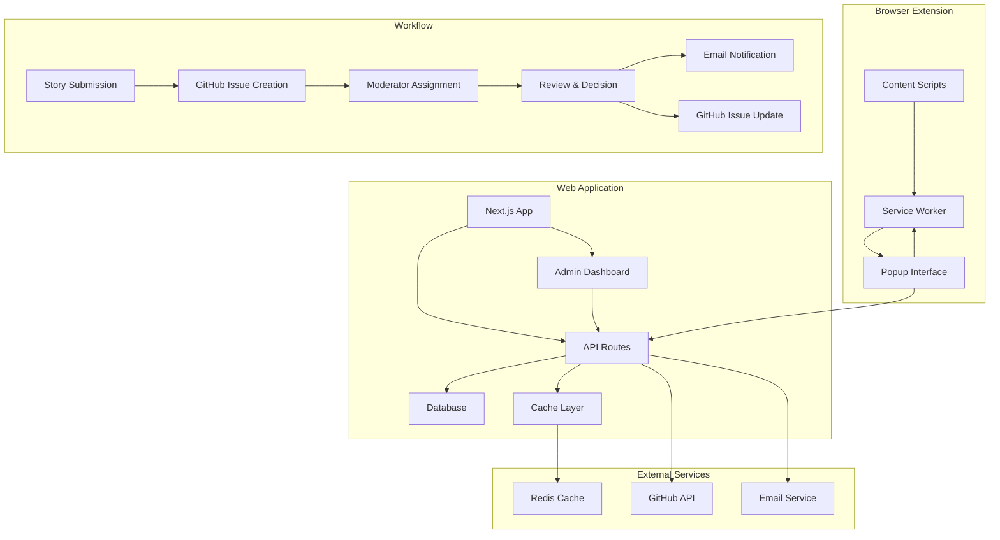

# Community Submission System Architecture

## Overview

The Pensive Index Community Submission System is a comprehensive platform that enables community members to submit stories via a browser extension, with integrated GitHub-based moderation workflows and admin dashboard management.

## System Architecture



## Core Components

### 1. Browser Extension (`src/extension/`)
- **Service Worker**: Background processing and API communication
- **Content Scripts**: Story parsing from fanfiction sites (AO3, FFNet)
- **Popup Interface**: React-based submission form
- **Site Parsers**: Extract story metadata from supported sites

### 2. API Layer (`app/api/`)
- **Submission API** (`v1/submissions/`): Handle story submissions
- **Admin API** (`admin/`): Queue management and moderation actions
- **Webhook Handler** (`webhooks/github/`): GitHub event processing
- **Health Checks**: Service monitoring endpoints

### 3. Admin Dashboard (`app/admin/`)
- **Submission Queue**: Filter and manage pending submissions
- **Moderation Interface**: Approve, reject, or request changes
- **Analytics Dashboard**: Performance and workload metrics
- **User Management**: Admin and moderator role assignment

### 4. GitHub Integration (`src/lib/github/`)
- **Issue Templates**: Automated issue creation with metadata
- **Webhook Processing**: Bidirectional sync with GitHub
- **Label Management**: Comprehensive tagging system
- **Status Tracking**: Real-time submission state updates

### 5. Email Notifications (`src/lib/notifications/`)
- **Template System**: Multi-stage workflow notifications
- **Delivery Tracking**: Monitor email status and retries
- **Admin Alerts**: Moderator assignments and system notifications

## Data Flow

### Submission Workflow

1. **User submits story via extension**
   ```
   Extension Popup → API → Database → GitHub Issue → Email Notification
   ```

2. **Moderator reviews submission**
   ```
   Admin Dashboard → Moderation Action → Database Update → GitHub Update → Email Notification
   ```

3. **GitHub webhook synchronization**
   ```
   GitHub Event → Webhook Handler → Database Update → Cache Invalidation
   ```

## Performance Optimizations

### Caching Strategy
- **Redis**: Distributed caching for API responses
- **Local Cache**: LRU cache for frequently accessed data
- **Query Optimization**: Database indexing and batch operations
- **Response Compression**: Automatic gzip for large payloads

### Database Indexing
- **Compound Indexes**: Multi-column indexes for complex queries
- **Partial Indexes**: Filtered indexes for specific use cases
- **Full-Text Search**: FTS virtual tables for story search
- **Performance Monitoring**: Query execution time tracking

## Security Considerations

### Authentication & Authorization
- **Clerk Integration**: User authentication and session management
- **Role-Based Access**: Admin, moderator, and user permissions
- **API Security**: Request validation and rate limiting
- **Extension Security**: Secure API communication and data handling

### Data Protection
- **Input Validation**: Comprehensive sanitization and validation
- **SQL Injection Prevention**: Parameterized queries and ORM usage
- **XSS Protection**: Content Security Policy and output encoding
- **CORS Configuration**: Restricted cross-origin access

## Deployment Architecture

### Production Stack
- **Frontend**: Next.js 14+ with App Router
- **Database**: SQLite with Drizzle ORM
- **Caching**: Redis for distributed caching
- **Hosting**: Vercel/Cloudflare deployment
- **Monitoring**: Performance and error tracking

### Development Environment
- **Local Development**: Next.js dev server with hot reload
- **Testing**: Vitest for unit tests, Playwright for E2E
- **Database**: Local SQLite with migrations
- **Extension**: Chrome DevTools for extension debugging

## Monitoring & Observability

### Performance Metrics
- **API Response Times**: <500ms for submission queries
- **Extension Performance**: <5s for story submission
- **Moderation Actions**: <10s for admin operations
- **Cache Hit Rates**: >80% for frequently accessed data

### Health Checks
- **Service Health**: `/api/health` endpoint monitoring
- **Database Connectivity**: Connection pool monitoring
- **External Services**: GitHub and email service status
- **Extension Functionality**: Site parser effectiveness

## Scaling Considerations

### Horizontal Scaling
- **Stateless Services**: API routes designed for horizontal scaling
- **Database Sharding**: Partition strategies for large datasets
- **Cache Distribution**: Redis cluster configuration
- **Load Balancing**: Multiple instance deployment

### Vertical Scaling
- **Resource Optimization**: Memory and CPU usage monitoring
- **Query Performance**: Database optimization and indexing
- **Cache Efficiency**: Memory usage and eviction policies
- **Extension Optimization**: Minimize resource consumption

## Integration Points

### GitHub Integration
- **Repository**: Story submissions tracked as GitHub issues
- **Webhooks**: Bidirectional synchronization of status updates
- **Labels**: Comprehensive tagging for issue organization
- **API Limits**: Rate limiting and quota management

### Email Service Integration
- **SMTP Configuration**: Email delivery service setup
- **Template Management**: HTML/text email templates
- **Delivery Tracking**: Status monitoring and retry logic
- **Notification Types**: Multi-stage workflow notifications

### Browser Extension Integration
- **Supported Sites**: AO3, FFNet with extensible parser system
- **API Communication**: Secure backend communication
- **User Experience**: Seamless submission flow
- **Error Handling**: Graceful failure and retry mechanisms