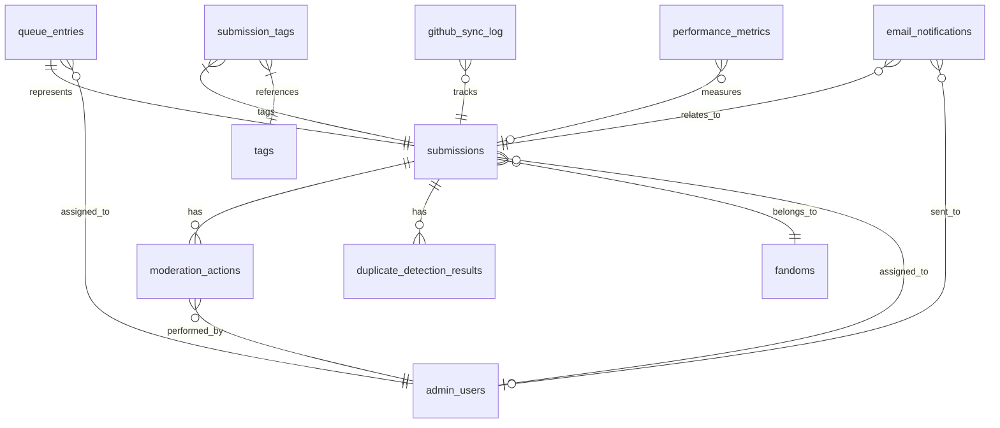

# Community Submission System Database Schema

## Overview

The Community Submission System extends The Pensive Index database with new tables and relationships to support story submissions, moderation workflows, and community contributions. This document provides a comprehensive overview of the database schema, relationships, and constraints.

## Database Technology

- **Primary Database**: SQLite via better-sqlite3
- **ORM**: Drizzle ORM for type-safe queries
- **Migration System**: Custom SQL migrations with version control
- **Backup Strategy**: Automated daily backups with point-in-time recovery

## Entity Relationship Diagram



## Table Definitions

### submissions

Primary table storing all story submission data.

```sql
CREATE TABLE submissions (
    -- Primary identifiers
    id TEXT PRIMARY KEY,                    -- Format: sub_YYYY_NNNNNN
    github_issue_number INTEGER UNIQUE,    -- Associated GitHub issue number

    -- Story metadata
    story_title TEXT NOT NULL,             -- Story title (1-200 chars)
    story_author TEXT NOT NULL,            -- Story author (1-100 chars)
    story_url TEXT NOT NULL UNIQUE,        -- Canonical story URL
    story_description TEXT,                -- Story description (max 2000 chars)

    -- Classification
    fandom_slug TEXT NOT NULL,             -- Reference to fandoms table

    -- Submission metadata
    submitter_email TEXT NOT NULL,         -- Submitter email address
    submitter_name TEXT,                   -- Optional submitter name
    submission_source TEXT NOT NULL DEFAULT 'web', -- 'extension', 'web', 'api'

    -- Workflow status
    status TEXT NOT NULL DEFAULT 'pending', -- 'pending', 'assigned', 'approved', 'rejected', 'duplicate'
    priority TEXT NOT NULL DEFAULT 'normal', -- 'low', 'normal', 'high', 'urgent'

    -- Timestamps
    submission_date INTEGER NOT NULL,       -- Unix timestamp
    created_at INTEGER NOT NULL,           -- Unix timestamp
    updated_at INTEGER NOT NULL,           -- Unix timestamp

    -- Foreign keys
    assigned_moderator_id TEXT,            -- References admin_users.id

    -- Constraints
    FOREIGN KEY (fandom_slug) REFERENCES fandoms(slug),
    FOREIGN KEY (assigned_moderator_id) REFERENCES admin_users(id),

    -- Check constraints
    CHECK (LENGTH(story_title) >= 1 AND LENGTH(story_title) <= 200),
    CHECK (LENGTH(story_author) >= 1 AND LENGTH(story_author) <= 100),
    CHECK (story_description IS NULL OR LENGTH(story_description) <= 2000),
    CHECK (status IN ('pending', 'assigned', 'approved', 'rejected', 'duplicate')),
    CHECK (priority IN ('low', 'normal', 'high', 'urgent')),
    CHECK (submission_source IN ('extension', 'web', 'api'))
);
```

**Indexes:**

```sql
-- Performance indexes
CREATE INDEX idx_submissions_status_priority ON submissions(status, priority, submission_date DESC);
CREATE INDEX idx_submissions_fandom_status ON submissions(fandom_slug, status);
CREATE INDEX idx_submissions_moderator ON submissions(assigned_moderator_id) WHERE assigned_moderator_id IS NOT NULL;
CREATE INDEX idx_submissions_created_at ON submissions(created_at DESC);
CREATE INDEX idx_submissions_github_issue ON submissions(github_issue_number) WHERE github_issue_number IS NOT NULL;

-- Search indexes
CREATE INDEX idx_submissions_search_title ON submissions(story_title COLLATE NOCASE);
CREATE INDEX idx_submissions_search_author ON submissions(story_author COLLATE NOCASE);
CREATE INDEX idx_submissions_search_url ON submissions(story_url);
```

### moderation_actions

Audit trail of all moderation activities.

```sql
CREATE TABLE moderation_actions (
    -- Primary identifiers
    id TEXT PRIMARY KEY,                    -- Format: mod_YYYY_NNNNNN
    submission_id TEXT NOT NULL,           -- Reference to submissions table
    moderator_id TEXT NOT NULL,            -- Reference to admin_users table

    -- Action details
    action TEXT NOT NULL,                   -- 'assigned', 'approved', 'rejected', 'flagged', 'commented'
    comment TEXT,                          -- Optional moderator comment
    previous_status TEXT,                  -- Status before this action
    new_status TEXT,                       -- Status after this action

    -- Metadata
    metadata TEXT,                         -- JSON metadata for action context

    -- Timestamps
    timestamp INTEGER NOT NULL,            -- Unix timestamp

    -- Foreign keys
    FOREIGN KEY (submission_id) REFERENCES submissions(id) ON DELETE CASCADE,
    FOREIGN KEY (moderator_id) REFERENCES admin_users(id),

    -- Check constraints
    CHECK (action IN ('assigned', 'approved', 'rejected', 'flagged', 'commented', 'priority_changed')),
    CHECK (LENGTH(comment) <= 1000 OR comment IS NULL)
);
```

**Indexes:**

```sql
CREATE INDEX idx_moderation_actions_submission ON moderation_actions(submission_id, timestamp DESC);
CREATE INDEX idx_moderation_actions_moderator ON moderation_actions(moderator_id, timestamp DESC);
CREATE INDEX idx_moderation_actions_action ON moderation_actions(action, timestamp DESC);
```

### queue_entries

Moderation queue management and workload balancing.

```sql
CREATE TABLE queue_entries (
    -- Primary identifiers
    id TEXT PRIMARY KEY,                    -- Format: que_YYYY_NNNNNN
    submission_id TEXT NOT NULL UNIQUE,    -- Reference to submissions table

    -- Queue management
    queue_position INTEGER NOT NULL,       -- Position in queue (1-based)
    priority TEXT NOT NULL DEFAULT 'normal', -- 'low', 'normal', 'high', 'urgent'
    complexity TEXT NOT NULL DEFAULT 'moderate', -- 'simple', 'moderate', 'complex'

    -- Assignment details
    assigned_moderator_id TEXT,            -- Currently assigned moderator
    assigned_at INTEGER,                   -- Assignment timestamp

    -- SLA tracking
    sla_deadline INTEGER,                  -- SLA deadline timestamp
    estimated_completion INTEGER,          -- Estimated completion timestamp

    -- Timestamps
    created_at INTEGER NOT NULL,           -- Entry creation timestamp
    updated_at INTEGER NOT NULL,           -- Last update timestamp

    -- Foreign keys
    FOREIGN KEY (submission_id) REFERENCES submissions(id) ON DELETE CASCADE,
    FOREIGN KEY (assigned_moderator_id) REFERENCES admin_users(id),

    -- Check constraints
    CHECK (queue_position > 0),
    CHECK (priority IN ('low', 'normal', 'high', 'urgent')),
    CHECK (complexity IN ('simple', 'moderate', 'complex')),
    CHECK (assigned_at IS NULL OR assigned_moderator_id IS NOT NULL)
);
```

**Indexes:**

```sql
CREATE UNIQUE INDEX idx_queue_entries_position ON queue_entries(queue_position);
CREATE INDEX idx_queue_entries_priority_position ON queue_entries(priority DESC, queue_position ASC);
CREATE INDEX idx_queue_entries_moderator ON queue_entries(assigned_moderator_id) WHERE assigned_moderator_id IS NOT NULL;
CREATE INDEX idx_queue_entries_sla ON queue_entries(sla_deadline) WHERE sla_deadline IS NOT NULL;
```

### duplicate_detection_results

Results from duplicate detection algorithms.

```sql
CREATE TABLE duplicate_detection_results (
    -- Primary identifiers
    id TEXT PRIMARY KEY,                    -- Format: dup_YYYY_NNNNNN
    submission_id TEXT NOT NULL,           -- Reference to submissions table

    -- Detection results
    is_duplicate BOOLEAN NOT NULL,         -- Whether submission is duplicate
    confidence_score REAL NOT NULL,       -- Confidence score (0.0-1.0)
    detection_method TEXT NOT NULL,       -- 'url', 'title', 'content', 'metadata'

    -- Similar submissions
    similar_submission_ids TEXT,           -- JSON array of similar submission IDs
    similarity_factors TEXT,               -- JSON array of similarity factors

    -- Algorithm details
    algorithm_version TEXT NOT NULL,       -- Detection algorithm version
    processing_time_ms INTEGER NOT NULL,  -- Processing time in milliseconds

    -- Timestamps
    detected_at INTEGER NOT NULL,          -- Detection timestamp

    -- Foreign keys
    FOREIGN KEY (submission_id) REFERENCES submissions(id) ON DELETE CASCADE,

    -- Check constraints
    CHECK (confidence_score >= 0.0 AND confidence_score <= 1.0),
    CHECK (detection_method IN ('url', 'title', 'content', 'metadata', 'composite')),
    CHECK (processing_time_ms >= 0)
);
```

**Indexes:**

```sql
CREATE INDEX idx_duplicate_detection_submission ON duplicate_detection_results(submission_id);
CREATE INDEX idx_duplicate_detection_is_duplicate ON duplicate_detection_results(is_duplicate, confidence_score DESC);
CREATE INDEX idx_duplicate_detection_confidence ON duplicate_detection_results(confidence_score DESC);
```

### extracted_metadata

Cached story metadata extracted from various websites.

```sql
CREATE TABLE extracted_metadata (
    -- Primary identifiers
    id TEXT PRIMARY KEY,                    -- Format: ext_YYYY_NNNNNN
    submission_id TEXT NOT NULL UNIQUE,    -- Reference to submissions table

    -- Extracted story data
    word_count INTEGER,                    -- Story word count
    chapter_count INTEGER,                 -- Number of chapters
    completion_status TEXT,                -- 'complete', 'in-progress', 'hiatus', 'abandoned'
    language TEXT,                         -- Story language
    content_rating TEXT,                   -- 'general', 'teen', 'mature', 'explicit'

    -- Dates
    published_date TEXT,                   -- ISO 8601 published date
    last_updated TEXT,                     -- ISO 8601 last update date
    completed_date TEXT,                   -- ISO 8601 completion date

    -- Statistics
    review_count INTEGER DEFAULT 0,       -- Number of reviews
    favorite_count INTEGER DEFAULT 0,     -- Number of favorites
    follow_count INTEGER DEFAULT 0,       -- Number of follows/subscriptions
    kudos_count INTEGER DEFAULT 0,        -- Number of kudos (AO3)
    bookmark_count INTEGER DEFAULT 0,     -- Number of bookmarks

    -- Additional metadata
    characters TEXT,                       -- JSON array of character names
    relationships TEXT,                    -- JSON array of relationship names
    warnings TEXT,                         -- JSON array of content warnings
    additional_tags TEXT,                  -- JSON array of additional tags

    -- Extraction details
    extractor_name TEXT NOT NULL,         -- Name of extractor used
    extractor_version TEXT NOT NULL,      -- Extractor version
    extraction_confidence REAL NOT NULL,  -- Extraction confidence (0.0-1.0)
    extraction_time_ms INTEGER NOT NULL,  -- Extraction time in milliseconds

    -- Timestamps
    extracted_at INTEGER NOT NULL,        -- Extraction timestamp

    -- Foreign keys
    FOREIGN KEY (submission_id) REFERENCES submissions(id) ON DELETE CASCADE,

    -- Check constraints
    CHECK (word_count IS NULL OR word_count >= 0),
    CHECK (chapter_count IS NULL OR chapter_count >= 1),
    CHECK (completion_status IS NULL OR completion_status IN ('complete', 'in-progress', 'hiatus', 'abandoned')),
    CHECK (content_rating IS NULL OR content_rating IN ('general', 'teen', 'mature', 'explicit')),
    CHECK (extraction_confidence >= 0.0 AND extraction_confidence <= 1.0)
);
```

**Indexes:**

```sql
CREATE INDEX idx_extracted_metadata_completion ON extracted_metadata(completion_status);
CREATE INDEX idx_extracted_metadata_word_count ON extracted_metadata(word_count DESC) WHERE word_count IS NOT NULL;
CREATE INDEX idx_extracted_metadata_extractor ON extracted_metadata(extractor_name, extractor_version);
CREATE INDEX idx_extracted_metadata_published ON extracted_metadata(published_date DESC) WHERE published_date IS NOT NULL;
```

### submission_tags

Many-to-many relationship between submissions and tags.

```sql
CREATE TABLE submission_tags (
    -- Composite primary key
    submission_id TEXT NOT NULL,           -- Reference to submissions table
    tag_id TEXT NOT NULL,                  -- Reference to tags table

    -- Tag metadata
    tag_source TEXT NOT NULL DEFAULT 'manual', -- 'manual', 'extracted', 'suggested', 'approved'
    confidence_score REAL,                -- Confidence for suggested tags (0.0-1.0)

    -- Timestamps
    created_at INTEGER NOT NULL,           -- Tag assignment timestamp

    -- Primary key and foreign keys
    PRIMARY KEY (submission_id, tag_id),
    FOREIGN KEY (submission_id) REFERENCES submissions(id) ON DELETE CASCADE,
    FOREIGN KEY (tag_id) REFERENCES tags(id),

    -- Check constraints
    CHECK (tag_source IN ('manual', 'extracted', 'suggested', 'approved')),
    CHECK (confidence_score IS NULL OR (confidence_score >= 0.0 AND confidence_score <= 1.0))
);
```

**Indexes:**

```sql
CREATE INDEX idx_submission_tags_submission ON submission_tags(submission_id);
CREATE INDEX idx_submission_tags_tag ON submission_tags(tag_id);
CREATE INDEX idx_submission_tags_source ON submission_tags(tag_source);
```

### email_notifications

Email notification tracking and audit trail.

```sql
CREATE TABLE email_notifications (
    -- Primary identifiers
    id TEXT PRIMARY KEY,                    -- Format: eml_YYYY_NNNNNN

    -- Recipients
    recipient_email TEXT NOT NULL,         -- Email recipient
    recipient_type TEXT NOT NULL,         -- 'submitter', 'moderator', 'admin'
    recipient_id TEXT,                     -- User/admin ID if applicable

    -- Email details
    email_type TEXT NOT NULL,             -- 'submission_confirmation', 'review_completed', etc.
    subject TEXT NOT NULL,                -- Email subject line
    template_name TEXT NOT NULL,          -- Template used for email
    template_version TEXT NOT NULL,       -- Template version

    -- Content
    email_data TEXT NOT NULL,             -- JSON data used to render template

    -- Delivery tracking
    delivery_status TEXT NOT NULL DEFAULT 'pending', -- 'pending', 'sent', 'delivered', 'failed', 'bounced'
    delivery_attempts INTEGER NOT NULL DEFAULT 0,     -- Number of delivery attempts
    last_attempt_at INTEGER,              -- Last delivery attempt timestamp
    delivered_at INTEGER,                 -- Successful delivery timestamp
    error_message TEXT,                   -- Error message if delivery failed

    -- References
    submission_id TEXT,                   -- Related submission (if applicable)
    moderation_action_id TEXT,            -- Related moderation action (if applicable)

    -- Timestamps
    created_at INTEGER NOT NULL,          -- Notification creation timestamp
    updated_at INTEGER NOT NULL,          -- Last update timestamp

    -- Foreign keys
    FOREIGN KEY (submission_id) REFERENCES submissions(id) ON DELETE SET NULL,
    FOREIGN KEY (moderation_action_id) REFERENCES moderation_actions(id) ON DELETE SET NULL,

    -- Check constraints
    CHECK (recipient_type IN ('submitter', 'moderator', 'admin')),
    CHECK (email_type IN ('submission_confirmation', 'review_completed', 'assignment_notification', 'escalation_alert', 'system_notification')),
    CHECK (delivery_status IN ('pending', 'sent', 'delivered', 'failed', 'bounced')),
    CHECK (delivery_attempts >= 0),
    CHECK (LENGTH(subject) >= 1 AND LENGTH(subject) <= 200)
);
```

**Indexes:**

```sql
CREATE INDEX idx_email_notifications_recipient ON email_notifications(recipient_email, created_at DESC);
CREATE INDEX idx_email_notifications_status ON email_notifications(delivery_status, created_at DESC);
CREATE INDEX idx_email_notifications_submission ON email_notifications(submission_id) WHERE submission_id IS NOT NULL;
CREATE INDEX idx_email_notifications_type ON email_notifications(email_type, created_at DESC);
```

### github_sync_log

GitHub synchronization tracking and audit.

```sql
CREATE TABLE github_sync_log (
    -- Primary identifiers
    id TEXT PRIMARY KEY,                    -- Format: git_YYYY_NNNNNN

    -- Sync details
    sync_type TEXT NOT NULL,              -- 'create_issue', 'update_issue', 'webhook_received'
    github_event_type TEXT,               -- GitHub event type (for webhooks)

    -- GitHub references
    github_issue_number INTEGER,          -- GitHub issue number
    github_delivery_id TEXT,              -- GitHub webhook delivery ID

    -- Submission reference
    submission_id TEXT,                   -- Related submission

    -- Sync data
    request_data TEXT,                    -- JSON request data sent to/from GitHub
    response_data TEXT,                   -- JSON response data from GitHub

    -- Status tracking
    sync_status TEXT NOT NULL,            -- 'success', 'failed', 'partial'
    error_message TEXT,                   -- Error message if sync failed
    retry_count INTEGER NOT NULL DEFAULT 0, -- Number of retry attempts

    -- Performance
    processing_time_ms INTEGER,           -- Processing time in milliseconds

    -- Timestamps
    started_at INTEGER NOT NULL,          -- Sync start timestamp
    completed_at INTEGER,                 -- Sync completion timestamp

    -- Foreign keys
    FOREIGN KEY (submission_id) REFERENCES submissions(id) ON DELETE SET NULL,

    -- Check constraints
    CHECK (sync_type IN ('create_issue', 'update_issue', 'webhook_received', 'bulk_sync')),
    CHECK (sync_status IN ('success', 'failed', 'partial')),
    CHECK (retry_count >= 0)
);
```

**Indexes:**

```sql
CREATE INDEX idx_github_sync_log_submission ON github_sync_log(submission_id) WHERE submission_id IS NOT NULL;
CREATE INDEX idx_github_sync_log_issue ON github_sync_log(github_issue_number) WHERE github_issue_number IS NOT NULL;
CREATE INDEX idx_github_sync_log_status ON github_sync_log(sync_status, started_at DESC);
CREATE INDEX idx_github_sync_log_type ON github_sync_log(sync_type, started_at DESC);
```

### performance_metrics

System performance tracking and monitoring.

```sql
CREATE TABLE performance_metrics (
    -- Primary identifiers
    id TEXT PRIMARY KEY,                    -- Format: perf_YYYY_NNNNNN

    -- Metric identification
    metric_type TEXT NOT NULL,            -- 'api_response', 'extraction', 'duplicate_detection', etc.
    endpoint_path TEXT,                   -- API endpoint (if applicable)
    operation_name TEXT NOT NULL,         -- Specific operation name

    -- Performance data
    duration_ms INTEGER NOT NULL,         -- Operation duration in milliseconds
    memory_used_mb REAL,                  -- Peak memory usage in MB
    cpu_usage_percent REAL,               -- CPU usage percentage

    -- Context data
    context_data TEXT,                    -- JSON context data
    user_agent TEXT,                      -- User agent (for web requests)
    ip_address TEXT,                      -- Client IP address

    -- Status
    status TEXT NOT NULL,                 -- 'success', 'error', 'timeout'
    error_type TEXT,                      -- Error type if status is 'error'

    -- References
    submission_id TEXT,                   -- Related submission (if applicable)
    user_id TEXT,                         -- Related user (if applicable)

    -- Timestamps
    measured_at INTEGER NOT NULL,         -- Measurement timestamp

    -- Foreign keys
    FOREIGN KEY (submission_id) REFERENCES submissions(id) ON DELETE SET NULL,

    -- Check constraints
    CHECK (metric_type IN ('api_response', 'extraction', 'duplicate_detection', 'queue_processing', 'github_sync', 'email_delivery')),
    CHECK (status IN ('success', 'error', 'timeout')),
    CHECK (duration_ms >= 0),
    CHECK (memory_used_mb IS NULL OR memory_used_mb >= 0),
    CHECK (cpu_usage_percent IS NULL OR (cpu_usage_percent >= 0 AND cpu_usage_percent <= 100))
);
```

**Indexes:**

```sql
CREATE INDEX idx_performance_metrics_type_time ON performance_metrics(metric_type, measured_at DESC);
CREATE INDEX idx_performance_metrics_endpoint ON performance_metrics(endpoint_path, measured_at DESC) WHERE endpoint_path IS NOT NULL;
CREATE INDEX idx_performance_metrics_duration ON performance_metrics(duration_ms DESC);
CREATE INDEX idx_performance_metrics_status ON performance_metrics(status, measured_at DESC);
```

## Views

### submission_queue_view

Comprehensive view combining submission and queue data.

```sql
CREATE VIEW submission_queue_view AS
SELECT
    s.id,
    s.story_title,
    s.story_author,
    s.story_url,
    s.fandom_slug,
    s.status,
    s.submission_date,
    s.created_at,
    s.updated_at,
    s.assigned_moderator_id,

    -- Queue information
    q.queue_position,
    q.priority,
    q.complexity,
    q.assigned_at,
    q.sla_deadline,
    q.estimated_completion,

    -- Moderator information
    au.name AS moderator_name,
    au.email AS moderator_email,

    -- GitHub information
    s.github_issue_number,

    -- Metadata counts
    (SELECT COUNT(*) FROM moderation_actions ma WHERE ma.submission_id = s.id) as action_count,
    (SELECT COUNT(*) FROM submission_tags st WHERE st.submission_id = s.id) as tag_count

FROM submissions s
LEFT JOIN queue_entries q ON s.id = q.submission_id
LEFT JOIN admin_users au ON s.assigned_moderator_id = au.id;
```

### moderator_performance_view

View for tracking moderator performance metrics.

```sql
CREATE VIEW moderator_performance_view AS
SELECT
    au.id AS moderator_id,
    au.name AS moderator_name,
    au.email AS moderator_email,

    -- Workload statistics
    COUNT(CASE WHEN s.status = 'assigned' THEN 1 END) as current_assigned,
    COUNT(CASE WHEN ma.action = 'approved' AND ma.timestamp >= unixepoch() - 86400 THEN 1 END) as approved_24h,
    COUNT(CASE WHEN ma.action = 'rejected' AND ma.timestamp >= unixepoch() - 86400 THEN 1 END) as rejected_24h,

    -- Performance metrics
    AVG(CASE
        WHEN ma.action IN ('approved', 'rejected')
        THEN (ma.timestamp - s.submission_date) / 3600.0
    END) as avg_review_time_hours,

    -- Quality indicators
    COUNT(CASE WHEN ma.action = 'approved' THEN 1 END) * 1.0 /
    NULLIF(COUNT(CASE WHEN ma.action IN ('approved', 'rejected') THEN 1 END), 0) as approval_rate

FROM admin_users au
LEFT JOIN submissions s ON au.id = s.assigned_moderator_id
LEFT JOIN moderation_actions ma ON au.id = ma.moderator_id
WHERE au.role IN ('moderator', 'admin', 'super_admin')
GROUP BY au.id, au.name, au.email;
```

## Triggers

### Update submission timestamps

```sql
CREATE TRIGGER update_submission_timestamp
    AFTER UPDATE ON submissions
    FOR EACH ROW
    WHEN NEW.updated_at = OLD.updated_at
BEGIN
    UPDATE submissions
    SET updated_at = unixepoch()
    WHERE id = NEW.id;
END;
```

### Maintain queue positions

```sql
CREATE TRIGGER maintain_queue_positions
    AFTER INSERT ON queue_entries
    FOR EACH ROW
BEGIN
    -- Shift existing entries down
    UPDATE queue_entries
    SET queue_position = queue_position + 1
    WHERE queue_position >= NEW.queue_position
    AND id != NEW.id;
END;
```

### Log moderation actions

```sql
CREATE TRIGGER log_submission_status_changes
    AFTER UPDATE OF status ON submissions
    FOR EACH ROW
    WHEN NEW.status != OLD.status
BEGIN
    INSERT INTO moderation_actions (
        id,
        submission_id,
        moderator_id,
        action,
        previous_status,
        new_status,
        timestamp
    ) VALUES (
        'mod_' || strftime('%Y', 'now') || '_' ||
        printf('%06d', (SELECT COALESCE(MAX(CAST(substr(id, 10) AS INTEGER)), 0) + 1
                       FROM moderation_actions
                       WHERE id LIKE 'mod_' || strftime('%Y', 'now') || '_%')),
        NEW.id,
        NEW.assigned_moderator_id,
        'status_changed',
        OLD.status,
        NEW.status,
        unixepoch()
    );
END;
```

## Stored Procedures (SQLite Functions)

### Calculate queue position

```sql
-- Custom function to calculate optimal queue position
CREATE OR REPLACE FUNCTION calculate_queue_position(
    p_priority TEXT,
    p_complexity TEXT,
    p_fandom_slug TEXT
) RETURNS INTEGER AS $$
BEGIN
    -- Implementation would go here in a full SQL database
    -- For SQLite, this logic is implemented in application code
END;
$$;
```

## Data Integrity Constraints

### Referential Integrity

1. **Submissions → Fandoms**: All submissions must reference valid fandoms
2. **Submissions → Admin Users**: Assigned moderators must be valid admin users
3. **Queue Entries → Submissions**: One-to-one relationship maintained
4. **Moderation Actions → Submissions**: Actions must reference valid submissions
5. **Submission Tags → Submissions/Tags**: Valid many-to-many relationships

### Business Logic Constraints

1. **Status Transitions**: Only valid status transitions allowed
2. **Queue Position Uniqueness**: No two queue entries can have same position
3. **Moderator Workload**: Configurable limits on assignments per moderator
4. **SLA Deadlines**: Automatic calculation based on priority and complexity
5. **Duplicate Prevention**: URL uniqueness enforced at database level

### Performance Constraints

1. **Index Coverage**: All frequent queries covered by appropriate indexes
2. **Query Timeout**: Complex queries must complete within 5 seconds
3. **Batch Size Limits**: Bulk operations limited to 1000 records
4. **Archive Strategy**: Old data archived after configurable retention period

## Migration Strategy

### Version Control

```sql
-- Migration tracking table
CREATE TABLE schema_migrations (
    version TEXT PRIMARY KEY,
    description TEXT NOT NULL,
    applied_at INTEGER NOT NULL,
    rollback_sql TEXT
);
```

### Migration Example

```sql
-- Migration: 005_add_performance_metrics.sql
BEGIN TRANSACTION;

-- Add performance metrics table
CREATE TABLE performance_metrics (
    -- Table definition as above
);

-- Add indexes
CREATE INDEX idx_performance_metrics_type_time ON performance_metrics(metric_type, measured_at DESC);

-- Update schema version
INSERT INTO schema_migrations (version, description, applied_at)
VALUES ('005', 'Add performance metrics tracking', unixepoch());

COMMIT;
```

## Backup and Recovery

### Backup Strategy

1. **Daily Full Backups**: Complete database backup every 24 hours
2. **Incremental Backups**: Transaction log backups every hour
3. **Cross-Region Replication**: Backups stored in multiple regions
4. **Point-in-Time Recovery**: Ability to recover to any point within 30 days

### Recovery Procedures

```sql
-- Example recovery commands
.backup main backup_file.db
.restore main backup_file.db

-- Verify backup integrity
PRAGMA integrity_check;
PRAGMA foreign_key_check;
```

## Performance Optimization

### Query Optimization Guidelines

1. **Index Usage**: All WHERE clauses covered by indexes
2. **Join Optimization**: Proper join order and index usage
3. **Subquery Elimination**: Replace subqueries with JOINs where possible
4. **Limit Results**: Always use LIMIT for large result sets

### Monitoring Queries

```sql
-- Find slow queries
SELECT
    sql,
    avg_duration_ms,
    execution_count
FROM query_performance_log
WHERE avg_duration_ms > 1000
ORDER BY avg_duration_ms DESC;

-- Monitor index usage
SELECT
    name,
    tbl,
    stat
FROM sqlite_stat1
ORDER BY stat DESC;
```

## Security Considerations

### Data Protection

1. **Sensitive Data**: Email addresses and personal information encrypted
2. **Access Control**: Row-level security based on user roles
3. **Audit Logging**: All data modifications logged with user context
4. **Data Retention**: Configurable retention policies for different data types

### SQL Injection Prevention

1. **Parameterized Queries**: All queries use parameterized statements
2. **Input Validation**: All inputs validated before database interaction
3. **Drizzle ORM**: Type-safe query building prevents injection attacks
4. **Prepared Statements**: All dynamic queries use prepared statements

This comprehensive database schema documentation provides complete coverage of the Community Submission System's data layer, ensuring proper implementation, maintenance, and scaling of the database infrastructure.