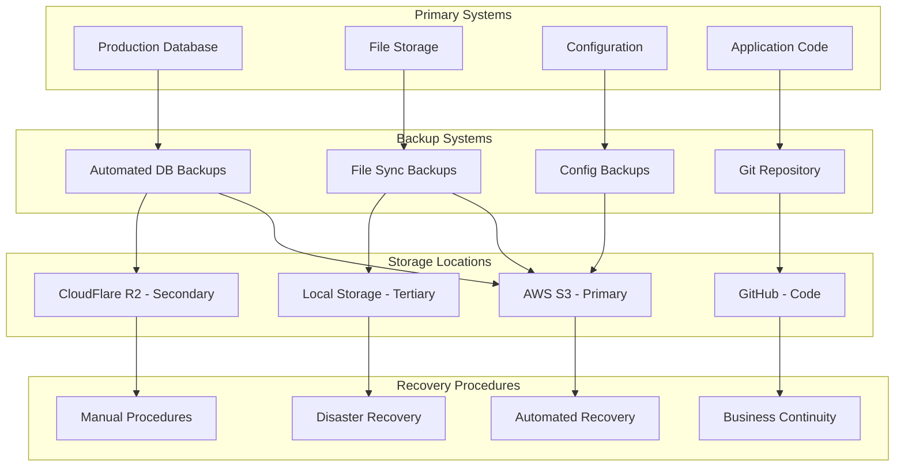

# Disaster Recovery and Backup Strategy

## Overview

This document outlines the comprehensive disaster recovery and backup strategy for The Pensive Index Community Submission System. It covers data protection, system recovery procedures, business continuity planning, and restoration processes.

## Recovery Objectives

### Recovery Time Objective (RTO)
- **Critical Systems**: 30 minutes
- **Database**: 15 minutes
- **User-facing Features**: 1 hour
- **Admin Functions**: 2 hours
- **Full System**: 4 hours

### Recovery Point Objective (RPO)
- **Database**: 5 minutes (max data loss)
- **File Storage**: 15 minutes
- **Configuration**: 1 hour
- **Code Repository**: Real-time (Git)

### Service Level Agreements
- **Uptime**: 99.9% (8.76 hours downtime/year)
- **Data Durability**: 99.999999999% (11 9's)
- **Backup Retention**: 90 days minimum
- **Geographic Distribution**: Multi-region redundancy

## Backup Architecture



## Database Backup Strategy

### 1. Automated Database Backups

**Backup Schedule:**
```typescript
// Database backup configuration
export const backupConfig = {
  // Full backups
  full: {
    frequency: 'daily',
    time: '02:00 UTC',
    retention: '30 days',
    compression: true,
    encryption: true
  },

  // Incremental backups
  incremental: {
    frequency: 'hourly',
    retention: '7 days',
    compression: true,
    encryption: true
  },

  // Transaction log backups
  transactionLog: {
    frequency: '5 minutes',
    retention: '24 hours',
    compression: false,
    encryption: true
  },

  // Point-in-time recovery
  pointInTime: {
    enabled: true,
    retention: '7 days',
    granularity: '1 minute'
  }
};
```

**Backup Implementation (`scripts/backup-database.ts`):**
```typescript
import { Database } from 'sqlite3';
import AWS from 'aws-sdk';
import { createGzip } from 'zlib';
import { createCipher } from 'crypto';
import fs from 'fs';
import path from 'path';

export class DatabaseBackupService {
  private s3: AWS.S3;
  private db: Database;

  constructor() {
    this.s3 = new AWS.S3({
      accessKeyId: process.env.AWS_ACCESS_KEY_ID,
      secretAccessKey: process.env.AWS_SECRET_ACCESS_KEY,
      region: process.env.AWS_REGION
    });
  }

  async performFullBackup(): Promise<BackupResult> {
    const backupId = `full_${Date.now()}`;
    const timestamp = new Date().toISOString();

    try {
      console.log(`Starting full backup: ${backupId}`);

      // 1. Create database backup
      const backupPath = await this.createDatabaseBackup(backupId);

      // 2. Compress backup
      const compressedPath = await this.compressBackup(backupPath);

      // 3. Encrypt backup
      const encryptedPath = await this.encryptBackup(compressedPath);

      // 4. Upload to S3
      const s3Key = await this.uploadToS3(encryptedPath, backupId);

      // 5. Upload to secondary storage
      await this.uploadToSecondaryStorage(encryptedPath, backupId);

      // 6. Verify backup integrity
      const verification = await this.verifyBackup(s3Key);

      // 7. Clean up local files
      await this.cleanupLocalFiles([backupPath, compressedPath, encryptedPath]);

      // 8. Record backup metadata
      await this.recordBackupMetadata({
        id: backupId,
        type: 'full',
        timestamp,
        size: verification.size,
        checksum: verification.checksum,
        s3Key,
        status: 'completed'
      });

      console.log(`Full backup completed: ${backupId}`);

      return {
        success: true,
        backupId,
        size: verification.size,
        duration: Date.now() - parseInt(backupId.split('_')[1])
      };

    } catch (error) {
      console.error(`Backup failed: ${backupId}`, error);

      await this.recordBackupMetadata({
        id: backupId,
        type: 'full',
        timestamp,
        status: 'failed',
        error: error.message
      });

      throw error;
    }
  }

  private async createDatabaseBackup(backupId: string): Promise<string> {
    const backupPath = path.join('/tmp', `${backupId}.db`);

    return new Promise((resolve, reject) => {
      const sourceDb = new Database(process.env.DATABASE_PATH);

      sourceDb.serialize(() => {
        sourceDb.run('BEGIN IMMEDIATE;', (err) => {
          if (err) return reject(err);

          // Use SQLite backup API
          const backup = sourceDb.backup(backupPath);

          backup.step(-1, (err) => {
            if (err) {
              sourceDb.run('ROLLBACK;');
              return reject(err);
            }

            backup.finish((err) => {
              sourceDb.run('COMMIT;');
              if (err) return reject(err);
              resolve(backupPath);
            });
          });
        });
      });
    });
  }

  private async compressBackup(backupPath: string): Promise<string> {
    const compressedPath = `${backupPath}.gz`;

    return new Promise((resolve, reject) => {
      const readStream = fs.createReadStream(backupPath);
      const writeStream = fs.createWriteStream(compressedPath);
      const gzip = createGzip();

      readStream
        .pipe(gzip)
        .pipe(writeStream)
        .on('finish', () => resolve(compressedPath))
        .on('error', reject);
    });
  }

  private async encryptBackup(compressedPath: string): Promise<string> {
    const encryptedPath = `${compressedPath}.enc`;
    const cipher = createCipher('aes-256-cbc', process.env.BACKUP_ENCRYPTION_KEY);

    return new Promise((resolve, reject) => {
      const readStream = fs.createReadStream(compressedPath);
      const writeStream = fs.createWriteStream(encryptedPath);

      readStream
        .pipe(cipher)
        .pipe(writeStream)
        .on('finish', () => resolve(encryptedPath))
        .on('error', reject);
    });
  }

  private async uploadToS3(filePath: string, backupId: string): Promise<string> {
    const key = `backups/database/${new Date().getFullYear()}/${new Date().getMonth() + 1}/${backupId}.enc`;
    const fileStream = fs.createReadStream(filePath);

    const params = {
      Bucket: process.env.BACKUP_S3_BUCKET,
      Key: key,
      Body: fileStream,
      ServerSideEncryption: 'AES256',
      StorageClass: 'STANDARD_IA',
      Metadata: {
        backupId,
        timestamp: new Date().toISOString(),
        type: 'database'
      }
    };

    await this.s3.upload(params).promise();
    return key;
  }

  private async uploadToSecondaryStorage(filePath: string, backupId: string): Promise<void> {
    // Implementation for secondary storage (CloudFlare R2, etc.)
    console.log(`Uploading ${backupId} to secondary storage`);
  }

  private async verifyBackup(s3Key: string): Promise<BackupVerification> {
    const params = {
      Bucket: process.env.BACKUP_S3_BUCKET,
      Key: s3Key
    };

    const headObject = await this.s3.headObject(params).promise();

    return {
      size: headObject.ContentLength || 0,
      checksum: headObject.ETag || '',
      lastModified: headObject.LastModified || new Date()
    };
  }

  private async cleanupLocalFiles(files: string[]): Promise<void> {
    for (const file of files) {
      try {
        fs.unlinkSync(file);
      } catch (error) {
        console.warn(`Failed to delete local file: ${file}`, error);
      }
    }
  }

  private async recordBackupMetadata(metadata: BackupMetadata): Promise<void> {
    // Store backup metadata in database or separate storage
    console.log('Recording backup metadata:', metadata);
  }

  async performIncrementalBackup(): Promise<BackupResult> {
    // Implementation for incremental backups
    // This would use WAL (Write-Ahead Logging) for SQLite
    throw new Error('Not implemented');
  }

  async performTransactionLogBackup(): Promise<BackupResult> {
    // Implementation for transaction log backups
    // This would backup the SQLite WAL file
    throw new Error('Not implemented');
  }
}

interface BackupResult {
  success: boolean;
  backupId: string;
  size: number;
  duration: number;
  error?: string;
}

interface BackupVerification {
  size: number;
  checksum: string;
  lastModified: Date;
}

interface BackupMetadata {
  id: string;
  type: 'full' | 'incremental' | 'transaction-log';
  timestamp: string;
  size?: number;
  checksum?: string;
  s3Key?: string;
  status: 'completed' | 'failed' | 'in-progress';
  error?: string;
}

export const databaseBackup = new DatabaseBackupService();
```

### 2. Backup Automation

**Automated Backup Scheduler (`scripts/backup-scheduler.ts`):**
```typescript
import cron from 'node-cron';
import { databaseBackup } from './backup-database';

export class BackupScheduler {
  start() {
    // Full backup - daily at 2 AM UTC
    cron.schedule('0 2 * * *', async () => {
      try {
        console.log('Starting scheduled full backup');
        await databaseBackup.performFullBackup();
        console.log('Scheduled full backup completed');
      } catch (error) {
        console.error('Scheduled full backup failed:', error);
        await this.sendBackupAlert('full', error);
      }
    });

    // Incremental backup - hourly
    cron.schedule('0 * * * *', async () => {
      try {
        console.log('Starting scheduled incremental backup');
        await databaseBackup.performIncrementalBackup();
        console.log('Scheduled incremental backup completed');
      } catch (error) {
        console.error('Scheduled incremental backup failed:', error);
        await this.sendBackupAlert('incremental', error);
      }
    });

    // Transaction log backup - every 5 minutes
    cron.schedule('*/5 * * * *', async () => {
      try {
        await databaseBackup.performTransactionLogBackup();
      } catch (error) {
        console.error('Transaction log backup failed:', error);
        await this.sendBackupAlert('transaction-log', error);
      }
    });

    // Backup verification - daily at 3 AM UTC
    cron.schedule('0 3 * * *', async () => {
      try {
        await this.verifyRecentBackups();
      } catch (error) {
        console.error('Backup verification failed:', error);
      }
    });

    // Cleanup old backups - weekly
    cron.schedule('0 4 * * 0', async () => {
      try {
        await this.cleanupOldBackups();
      } catch (error) {
        console.error('Backup cleanup failed:', error);
      }
    });
  }

  private async sendBackupAlert(type: string, error: Error): Promise<void> {
    // Send alert to monitoring system
    console.log(`Backup alert: ${type} backup failed - ${error.message}`);
  }

  private async verifyRecentBackups(): Promise<void> {
    // Verify backups from the last 24 hours
    console.log('Verifying recent backups');
  }

  private async cleanupOldBackups(): Promise<void> {
    // Remove backups older than retention period
    console.log('Cleaning up old backups');
  }
}

export const backupScheduler = new BackupScheduler();
```

## File Storage Backup

### 1. File Synchronization

**File Backup Service (`scripts/backup-files.ts`):**
```typescript
import AWS from 'aws-sdk';
import { glob } from 'glob';
import fs from 'fs';
import path from 'path';
import crypto from 'crypto';

export class FileBackupService {
  private s3: AWS.S3;

  constructor() {
    this.s3 = new AWS.S3({
      accessKeyId: process.env.AWS_ACCESS_KEY_ID,
      secretAccessKey: process.env.AWS_SECRET_ACCESS_KEY,
      region: process.env.AWS_REGION
    });
  }

  async backupFiles(): Promise<void> {
    const filesToBackup = [
      'public/**/*',
      'assets/**/*',
      '.env.local',
      'next.config.js',
      'package.json',
      'tsconfig.json'
    ];

    for (const pattern of filesToBackup) {
      const files = await glob(pattern, { ignore: 'node_modules/**' });

      for (const file of files) {
        await this.backupFile(file);
      }
    }
  }

  private async backupFile(filePath: string): Promise<void> {
    try {
      const stats = fs.statSync(filePath);

      if (stats.isDirectory()) return;

      const fileContent = fs.readFileSync(filePath);
      const checksum = crypto.createHash('md5').update(fileContent).digest('hex');

      // Check if file has changed
      const s3Key = `files/${filePath}`;
      const hasChanged = await this.fileHasChanged(s3Key, checksum);

      if (hasChanged) {
        await this.s3.upload({
          Bucket: process.env.BACKUP_S3_BUCKET,
          Key: s3Key,
          Body: fileContent,
          Metadata: {
            checksum,
            originalPath: filePath,
            timestamp: new Date().toISOString()
          }
        }).promise();

        console.log(`Backed up: ${filePath}`);
      }
    } catch (error) {
      console.error(`Failed to backup file: ${filePath}`, error);
    }
  }

  private async fileHasChanged(s3Key: string, currentChecksum: string): Promise<boolean> {
    try {
      const headObject = await this.s3.headObject({
        Bucket: process.env.BACKUP_S3_BUCKET,
        Key: s3Key
      }).promise();

      const storedChecksum = headObject.Metadata?.checksum;
      return storedChecksum !== currentChecksum;
    } catch (error) {
      // File doesn't exist in S3, needs backup
      return true;
    }
  }
}

export const fileBackup = new FileBackupService();
```

## Recovery Procedures

### 1. Database Recovery

**Database Recovery Service (`scripts/recovery-database.ts`):**
```typescript
export class DatabaseRecoveryService {
  private s3: AWS.S3;

  constructor() {
    this.s3 = new AWS.S3({
      accessKeyId: process.env.AWS_ACCESS_KEY_ID,
      secretAccessKey: process.env.AWS_SECRET_ACCESS_KEY,
      region: process.env.AWS_REGION
    });
  }

  async recoverFromBackup(backupId?: string, pointInTime?: Date): Promise<RecoveryResult> {
    try {
      console.log('Starting database recovery');

      let backupToRestore: BackupMetadata;

      if (pointInTime) {
        backupToRestore = await this.findBackupForPointInTime(pointInTime);
      } else if (backupId) {
        backupToRestore = await this.getBackupMetadata(backupId);
      } else {
        backupToRestore = await this.getLatestBackup();
      }

      if (!backupToRestore) {
        throw new Error('No suitable backup found');
      }

      console.log(`Restoring from backup: ${backupToRestore.id}`);

      // 1. Stop application
      await this.stopApplication();

      // 2. Backup current database (if exists)
      await this.backupCurrentDatabase();

      // 3. Download backup from S3
      const localBackupPath = await this.downloadBackup(backupToRestore);

      // 4. Decrypt and decompress
      const restoredDbPath = await this.restoreBackupFile(localBackupPath);

      // 5. Replace current database
      await this.replaceDatabase(restoredDbPath);

      // 6. Apply point-in-time recovery if needed
      if (pointInTime) {
        await this.applyPointInTimeRecovery(backupToRestore.timestamp, pointInTime);
      }

      // 7. Verify database integrity
      await this.verifyDatabaseIntegrity();

      // 8. Start application
      await this.startApplication();

      // 9. Run post-recovery tests
      await this.runPostRecoveryTests();

      console.log('Database recovery completed successfully');

      return {
        success: true,
        backupId: backupToRestore.id,
        recoveryTime: new Date(),
        dataLoss: pointInTime ? this.calculateDataLoss(pointInTime) : '0 minutes'
      };

    } catch (error) {
      console.error('Database recovery failed:', error);

      // Attempt to restore previous state
      await this.rollbackRecovery();

      throw error;
    }
  }

  private async findBackupForPointInTime(targetTime: Date): Promise<BackupMetadata> {
    // Find the latest full backup before the target time
    const fullBackup = await this.findLatestFullBackupBefore(targetTime);

    if (!fullBackup) {
      throw new Error('No full backup found before target time');
    }

    return fullBackup;
  }

  private async getLatestBackup(): Promise<BackupMetadata> {
    // Get the most recent successful backup
    const params = {
      Bucket: process.env.BACKUP_S3_BUCKET,
      Prefix: 'backups/database/',
      MaxKeys: 1
    };

    const result = await this.s3.listObjectsV2(params).promise();

    if (!result.Contents || result.Contents.length === 0) {
      throw new Error('No backups found');
    }

    const latestBackup = result.Contents[0];
    return this.parseBackupMetadata(latestBackup);
  }

  private async downloadBackup(backup: BackupMetadata): Promise<string> {
    const localPath = `/tmp/restore_${Date.now()}.enc`;

    const params = {
      Bucket: process.env.BACKUP_S3_BUCKET,
      Key: backup.s3Key
    };

    const s3Object = await this.s3.getObject(params).promise();
    fs.writeFileSync(localPath, s3Object.Body as Buffer);

    return localPath;
  }

  private async restoreBackupFile(encryptedPath: string): Promise<string> {
    // 1. Decrypt
    const decryptedPath = await this.decryptFile(encryptedPath);

    // 2. Decompress
    const decompressedPath = await this.decompressFile(decryptedPath);

    return decompressedPath;
  }

  private async decryptFile(encryptedPath: string): Promise<string> {
    const decryptedPath = encryptedPath.replace('.enc', '');
    const decipher = crypto.createDecipher('aes-256-cbc', process.env.BACKUP_ENCRYPTION_KEY);

    return new Promise((resolve, reject) => {
      const readStream = fs.createReadStream(encryptedPath);
      const writeStream = fs.createWriteStream(decryptedPath);

      readStream
        .pipe(decipher)
        .pipe(writeStream)
        .on('finish', () => resolve(decryptedPath))
        .on('error', reject);
    });
  }

  private async decompressFile(compressedPath: string): Promise<string> {
    const decompressedPath = compressedPath.replace('.gz', '');
    const gunzip = createGunzip();

    return new Promise((resolve, reject) => {
      const readStream = fs.createReadStream(compressedPath);
      const writeStream = fs.createWriteStream(decompressedPath);

      readStream
        .pipe(gunzip)
        .pipe(writeStream)
        .on('finish', () => resolve(decompressedPath))
        .on('error', reject);
    });
  }

  private async replaceDatabase(restoredDbPath: string): Promise<void> {
    const currentDbPath = process.env.DATABASE_PATH;

    // Move current database to backup location
    if (fs.existsSync(currentDbPath)) {
      fs.renameSync(currentDbPath, `${currentDbPath}.recovery-backup`);
    }

    // Move restored database to current location
    fs.renameSync(restoredDbPath, currentDbPath);
  }

  private async applyPointInTimeRecovery(backupTime: Date, targetTime: Date): Promise<void> {
    // Apply transaction logs between backup time and target time
    // This would require WAL (Write-Ahead Logging) implementation
    console.log(`Applying point-in-time recovery from ${backupTime} to ${targetTime}`);
  }

  private async verifyDatabaseIntegrity(): Promise<void> {
    // Run PRAGMA integrity_check
    const db = new Database(process.env.DATABASE_PATH);

    return new Promise((resolve, reject) => {
      db.get('PRAGMA integrity_check', (err, row) => {
        if (err) return reject(err);

        if (row && row['integrity_check'] === 'ok') {
          resolve();
        } else {
          reject(new Error('Database integrity check failed'));
        }
      });
    });
  }

  private async stopApplication(): Promise<void> {
    // Implementation to gracefully stop the application
    console.log('Stopping application for recovery');
  }

  private async startApplication(): Promise<void> {
    // Implementation to start the application
    console.log('Starting application after recovery');
  }

  private async runPostRecoveryTests(): Promise<void> {
    // Run basic functionality tests
    console.log('Running post-recovery tests');
  }

  private async rollbackRecovery(): Promise<void> {
    // Restore previous database if recovery failed
    const currentDbPath = process.env.DATABASE_PATH;
    const backupDbPath = `${currentDbPath}.recovery-backup`;

    if (fs.existsSync(backupDbPath)) {
      fs.renameSync(backupDbPath, currentDbPath);
      console.log('Recovery rolled back to previous state');
    }
  }

  private calculateDataLoss(targetTime: Date): string {
    const now = new Date();
    const diffMs = now.getTime() - targetTime.getTime();
    const diffMinutes = Math.floor(diffMs / 60000);

    if (diffMinutes < 60) {
      return `${diffMinutes} minutes`;
    } else if (diffMinutes < 1440) {
      return `${Math.floor(diffMinutes / 60)} hours`;
    } else {
      return `${Math.floor(diffMinutes / 1440)} days`;
    }
  }
}

interface RecoveryResult {
  success: boolean;
  backupId: string;
  recoveryTime: Date;
  dataLoss: string;
  error?: string;
}

export const databaseRecovery = new DatabaseRecoveryService();
```

### 2. Application Recovery

**Application Recovery Procedures:**

```bash
#!/bin/bash
# recovery-procedures.sh

# 1. Quick Recovery (Rolling back deployment)
quick_recovery() {
    echo "Starting quick recovery..."

    # Revert to previous deployment
    vercel --prod rollback

    # Verify application is working
    curl -f https://the-pensive-index.org/api/health || exit 1

    echo "Quick recovery completed"
}

# 2. Database Recovery
database_recovery() {
    echo "Starting database recovery..."

    # Stop application traffic
    # (Implementation depends on load balancer)

    # Run database recovery
    npm run recovery:database

    # Restart application
    vercel --prod deploy

    echo "Database recovery completed"
}

# 3. Full System Recovery
full_system_recovery() {
    echo "Starting full system recovery..."

    # 1. Restore database
    database_recovery

    # 2. Restore file storage
    npm run recovery:files

    # 3. Restore configuration
    npm run recovery:config

    # 4. Deploy application
    vercel --prod deploy

    # 5. Run health checks
    npm run test:health

    echo "Full system recovery completed"
}

# 4. Disaster Recovery
disaster_recovery() {
    echo "Starting disaster recovery..."

    # 1. Set up new infrastructure
    npm run setup:infrastructure

    # 2. Restore from offsite backups
    npm run recovery:offsite

    # 3. Update DNS to point to new infrastructure
    npm run update:dns

    # 4. Verify system functionality
    npm run test:disaster-recovery

    echo "Disaster recovery completed"
}

case "$1" in
    "quick") quick_recovery ;;
    "database") database_recovery ;;
    "full") full_system_recovery ;;
    "disaster") disaster_recovery ;;
    *) echo "Usage: $0 {quick|database|full|disaster}" ;;
esac
```

## Business Continuity

### 1. Incident Response Team

**Team Structure:**
```typescript
export const incidentResponseTeam = {
  incidentCommander: {
    primary: 'john.doe@company.com',
    backup: 'jane.smith@company.com',
    responsibilities: [
      'Overall incident coordination',
      'Communication with stakeholders',
      'Decision making authority'
    ]
  },

  technicalLead: {
    primary: 'tech.lead@company.com',
    backup: 'senior.dev@company.com',
    responsibilities: [
      'Technical troubleshooting',
      'Recovery execution',
      'System restoration'
    ]
  },

  communicationsLead: {
    primary: 'comms@company.com',
    backup: 'pr@company.com',
    responsibilities: [
      'User communication',
      'Status page updates',
      'Media relations'
    ]
  },

  businessLead: {
    primary: 'business@company.com',
    backup: 'product@company.com',
    responsibilities: [
      'Business impact assessment',
      'Priority decisions',
      'Stakeholder management'
    ]
  }
};
```

### 2. Communication Plan

**Status Page Configuration:**
```typescript
export class StatusPageManager {
  async updateIncidentStatus(incident: Incident, status: IncidentStatus) {
    // Update status page
    await this.updateStatusPage({
      title: incident.title,
      status: status.level,
      message: status.message,
      timestamp: new Date(),
      components: status.affectedComponents
    });

    // Send notifications
    await this.sendNotifications(incident, status);

    // Log status update
    await this.logStatusUpdate(incident.id, status);
  }

  private async sendNotifications(incident: Incident, status: IncidentStatus) {
    const notifications = [];

    // Email subscribers
    if (status.level === 'major' || status.level === 'critical') {
      notifications.push(this.emailSubscribers(incident, status));
    }

    // SMS for critical incidents
    if (status.level === 'critical') {
      notifications.push(this.smsSubscribers(incident, status));
    }

    // Social media updates
    if (status.level === 'major' || status.level === 'critical') {
      notifications.push(this.updateSocialMedia(incident, status));
    }

    await Promise.all(notifications);
  }
}
```

### 3. Recovery Testing

**Automated Recovery Testing (`scripts/test-recovery.ts`):**
```typescript
export class RecoveryTester {
  async runRecoveryTests(): Promise<RecoveryTestResults> {
    const results: RecoveryTestResults = {
      databaseRecovery: await this.testDatabaseRecovery(),
      fileRecovery: await this.testFileRecovery(),
      applicationRecovery: await this.testApplicationRecovery(),
      fullSystemRecovery: await this.testFullSystemRecovery()
    };

    return results;
  }

  private async testDatabaseRecovery(): Promise<TestResult> {
    try {
      // Create test backup
      const testBackup = await this.createTestBackup();

      // Perform recovery in test environment
      await this.recoverInTestEnvironment(testBackup);

      // Verify data integrity
      const integrityCheck = await this.verifyTestDataIntegrity();

      return {
        success: true,
        duration: integrityCheck.duration,
        details: 'Database recovery test passed'
      };
    } catch (error) {
      return {
        success: false,
        error: error.message,
        details: 'Database recovery test failed'
      };
    }
  }

  private async testApplicationRecovery(): Promise<TestResult> {
    try {
      // Deploy to test environment
      await this.deployToTest();

      // Run health checks
      const healthCheck = await this.runHealthChecks();

      // Run functional tests
      const functionalTests = await this.runFunctionalTests();

      return {
        success: healthCheck.success && functionalTests.success,
        duration: healthCheck.duration + functionalTests.duration,
        details: 'Application recovery test completed'
      };
    } catch (error) {
      return {
        success: false,
        error: error.message,
        details: 'Application recovery test failed'
      };
    }
  }
}

interface RecoveryTestResults {
  databaseRecovery: TestResult;
  fileRecovery: TestResult;
  applicationRecovery: TestResult;
  fullSystemRecovery: TestResult;
}

interface TestResult {
  success: boolean;
  duration?: number;
  error?: string;
  details: string;
}
```

### 4. Disaster Recovery Drills

**Monthly DR Drill Schedule:**
```typescript
export const drillSchedule = {
  monthly: {
    week1: 'Database recovery drill',
    week2: 'Application failover drill',
    week3: 'Full system recovery drill',
    week4: 'Communication and coordination drill'
  },

  quarterly: {
    q1: 'Multi-region failover drill',
    q2: 'Extended outage simulation',
    q3: 'Security incident response drill',
    q4: 'Annual disaster recovery exercise'
  },

  procedures: {
    preWork: [
      'Schedule drill with all team members',
      'Prepare test environment',
      'Create drill scenario documentation',
      'Set up monitoring and metrics collection'
    ],

    execution: [
      'Execute planned scenario',
      'Follow documented procedures',
      'Collect timing and effectiveness metrics',
      'Document any deviations or issues'
    ],

    postWork: [
      'Conduct post-drill review meeting',
      'Update procedures based on findings',
      'Create improvement action items',
      'Schedule follow-up activities'
    ]
  }
};
```

## Compliance and Audit

### 1. Backup Compliance

**Compliance Requirements:**
```typescript
export const complianceRequirements = {
  retention: {
    daily: '30 days minimum',
    weekly: '12 weeks minimum',
    monthly: '12 months minimum',
    yearly: '7 years minimum'
  },

  encryption: {
    inTransit: 'TLS 1.3 minimum',
    atRest: 'AES-256 minimum',
    keyManagement: 'HSM or equivalent'
  },

  testing: {
    frequency: 'Monthly minimum',
    scope: 'Full recovery process',
    documentation: 'Required for each test',
    reporting: 'Quarterly compliance reports'
  },

  access: {
    authentication: 'Multi-factor required',
    authorization: 'Role-based access control',
    logging: 'All access must be logged',
    monitoring: 'Real-time access monitoring'
  }
};
```

### 2. Audit Trail

**Audit Logging Service (`lib/audit/backup-audit.ts`):**
```typescript
export class BackupAuditService {
  async logBackupEvent(event: BackupAuditEvent): Promise<void> {
    const auditLog = {
      timestamp: new Date().toISOString(),
      eventId: crypto.randomUUID(),
      eventType: event.type,
      userId: event.userId,
      details: event.details,
      success: event.success,
      checksum: this.calculateEventChecksum(event)
    };

    // Store in secure audit log
    await this.storeAuditLog(auditLog);

    // Send to SIEM if critical event
    if (this.isCriticalEvent(event)) {
      await this.sendToSIEM(auditLog);
    }
  }

  async generateComplianceReport(startDate: Date, endDate: Date): Promise<ComplianceReport> {
    const auditLogs = await this.getAuditLogs(startDate, endDate);

    return {
      reportId: crypto.randomUUID(),
      period: { start: startDate, end: endDate },
      backupStats: this.calculateBackupStats(auditLogs),
      recoveryStats: this.calculateRecoveryStats(auditLogs),
      complianceStatus: this.assessCompliance(auditLogs),
      recommendations: this.generateRecommendations(auditLogs)
    };
  }
}

interface BackupAuditEvent {
  type: 'backup_started' | 'backup_completed' | 'backup_failed' | 'recovery_started' | 'recovery_completed';
  userId: string;
  details: Record<string, any>;
  success: boolean;
}

interface ComplianceReport {
  reportId: string;
  period: { start: Date; end: Date };
  backupStats: BackupStatistics;
  recoveryStats: RecoveryStatistics;
  complianceStatus: ComplianceStatus;
  recommendations: string[];
}
```

This disaster recovery and backup strategy provides comprehensive protection for The Pensive Index Community Submission System, ensuring business continuity and data protection in all scenarios.