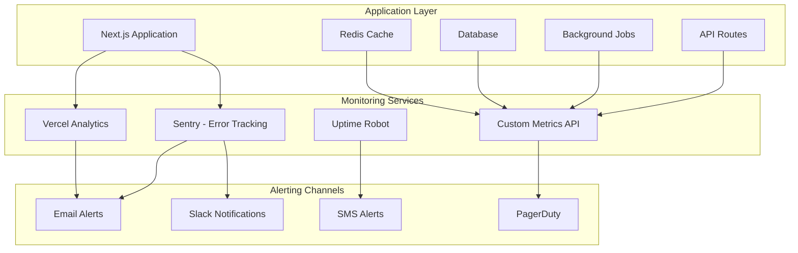

# Monitoring and Alerting Guide

## Overview

This guide provides comprehensive monitoring and alerting setup for The Pensive Index Community Submission System. It covers application performance monitoring, error tracking, uptime monitoring, and automated alerting procedures.

## Monitoring Architecture



## Core Metrics

### Application Performance Metrics

| Metric              | Target  | Warning | Critical | Description                       |
| ------------------- | ------- | ------- | -------- | --------------------------------- |
| Response Time (P95) | < 500ms | > 1s    | > 5s     | API response time 95th percentile |
| Response Time (P99) | < 1s    | > 2s    | > 10s    | API response time 99th percentile |
| Error Rate          | < 0.1%  | > 1%    | > 5%     | Percentage of failed requests     |
| Uptime              | > 99.9% | < 99.5% | < 99%    | Application availability          |
| Database Response   | < 100ms | > 500ms | > 2s     | Database query response time      |
| Cache Hit Rate      | > 80%   | < 70%   | < 50%    | Redis cache effectiveness         |

### Business Metrics

| Metric                  | Target  | Warning | Critical  | Description                  |
| ----------------------- | ------- | ------- | --------- | ---------------------------- |
| Submission Success Rate | > 95%   | < 90%   | < 80%     | Successful story submissions |
| Queue Processing Time   | < 24h   | > 48h   | > 72h     | Average moderation time      |
| Extension Usage         | Growing | Flat    | Declining | Browser extension adoption   |
| User Engagement         | > 70%   | < 60%   | < 50%     | Weekly active users          |

### Infrastructure Metrics

| Metric          | Target  | Warning | Critical | Description                    |
| --------------- | ------- | ------- | -------- | ------------------------------ |
| Memory Usage    | < 80%   | > 85%   | > 95%    | Application memory consumption |
| CPU Usage       | < 70%   | > 80%   | > 90%    | Server CPU utilization         |
| Disk Usage      | < 80%   | > 90%   | > 95%    | Database storage usage         |
| Network Latency | < 100ms | > 200ms | > 500ms  | Network response time          |

## Monitoring Tools Setup

### 1. Sentry Error Tracking

**Installation:**
```bash
npm install @sentry/nextjs @sentry/tracing
```

**Configuration (`sentry.client.config.js`):**
```javascript
import * as Sentry from '@sentry/nextjs';

Sentry.init({
  dsn: process.env.SENTRY_DSN,
  environment: process.env.NODE_ENV,

  // Performance monitoring
  tracesSampleRate: process.env.NODE_ENV === 'production' ? 0.1 : 1.0,

  // Release tracking
  release: process.env.VERCEL_GIT_COMMIT_SHA,

  // Error filtering
  beforeSend(event, hint) {
    // Don't send errors for specific scenarios
    if (event.exception) {
      const error = event.exception.values[0];
      if (error.type === 'ChunkLoadError') {
        return null; // Ignore chunk loading errors
      }
    }

    // Remove sensitive data
    if (event.extra) {
      delete event.extra.password;
      delete event.extra.token;
      delete event.extra.apiKey;
    }

    return event;
  },

  // Performance monitoring
  beforeTransaction(event) {
    // Only sample API routes and critical pages
    if (event.name.startsWith('/api/') ||
        event.name.includes('submissions') ||
        event.name.includes('admin')) {
      return event;
    }
    return null;
  }
});
```

**Server Configuration (`sentry.server.config.js`):**
```javascript
import * as Sentry from '@sentry/nextjs';

Sentry.init({
  dsn: process.env.SENTRY_DSN,
  environment: process.env.NODE_ENV,
  tracesSampleRate: 0.1,

  // Server-specific configuration
  integrations: [
    new Sentry.Integrations.Http({ tracing: true }),
    new Sentry.Integrations.Express({ app: undefined }),
  ],

  // Custom error handling
  beforeSend(event) {
    // Add server context
    event.server_name = process.env.VERCEL_REGION || 'unknown';
    event.tags = {
      ...event.tags,
      server: true
    };

    return event;
  }
});
```

### 2. Custom Metrics Collection

**Metrics Collection Service (`lib/monitoring/metrics.ts`):**
```typescript
import { Redis } from 'ioredis';

export class MetricsCollector {
  private redis: Redis;
  private metricsBuffer: Array<Metric> = [];

  constructor() {
    this.redis = new Redis(process.env.REDIS_URL);

    // Flush metrics every 30 seconds
    setInterval(() => this.flushMetrics(), 30000);
  }

  // Record API response time
  recordResponseTime(endpoint: string, duration: number, status: number) {
    this.metricsBuffer.push({
      type: 'api_response_time',
      timestamp: Date.now(),
      tags: { endpoint, status: status.toString() },
      value: duration
    });
  }

  // Record business metrics
  recordSubmission(success: boolean, source: string, processingTime: number) {
    this.metricsBuffer.push({
      type: 'submission',
      timestamp: Date.now(),
      tags: { success: success.toString(), source },
      value: processingTime
    });
  }

  // Record error events
  recordError(type: string, severity: 'low' | 'medium' | 'high' | 'critical') {
    this.metricsBuffer.push({
      type: 'error',
      timestamp: Date.now(),
      tags: { error_type: type, severity },
      value: 1
    });
  }

  private async flushMetrics() {
    if (this.metricsBuffer.length === 0) return;

    try {
      const metrics = this.metricsBuffer.splice(0);

      // Store in Redis for aggregation
      for (const metric of metrics) {
        await this.redis.zadd(
          `metrics:${metric.type}`,
          metric.timestamp,
          JSON.stringify(metric)
        );
      }

      // Send to external monitoring service
      await this.sendToExternalService(metrics);
    } catch (error) {
      console.error('Failed to flush metrics:', error);
    }
  }

  private async sendToExternalService(metrics: Metric[]) {
    // Implementation depends on your monitoring service
    // Example: DataDog, New Relic, Custom analytics
  }
}

interface Metric {
  type: string;
  timestamp: number;
  tags: Record<string, string>;
  value: number;
}

export const metrics = new MetricsCollector();
```

**Middleware for Automatic Metrics (`middleware/metrics.ts`):**
```typescript
import { NextRequest, NextResponse } from 'next/server';
import { metrics } from '@/lib/monitoring/metrics';

export function metricsMiddleware(request: NextRequest) {
  const start = Date.now();

  // Continue with the request
  const response = NextResponse.next();

  // Record metrics after response
  response.headers.set('x-response-time', (Date.now() - start).toString());

  // Async metrics recording (don't block response)
  setImmediate(() => {
    metrics.recordResponseTime(
      request.nextUrl.pathname,
      Date.now() - start,
      response.status
    );
  });

  return response;
}
```

### 3. Database Monitoring

**Database Health Check (`lib/monitoring/database.ts`):**
```typescript
import { db } from '@/lib/database';

export class DatabaseMonitor {
  async checkHealth(): Promise<DatabaseHealth> {
    const start = Date.now();

    try {
      // Test connection with simple query
      await db.select().from('submissions').limit(1);

      const responseTime = Date.now() - start;

      // Check database size
      const dbStats = await this.getDatabaseStats();

      return {
        status: 'healthy',
        responseTime,
        ...dbStats
      };
    } catch (error) {
      return {
        status: 'unhealthy',
        error: error.message,
        responseTime: Date.now() - start
      };
    }
  }

  private async getDatabaseStats() {
    try {
      // Get table sizes and row counts
      const stats = await db.execute(`
        SELECT
          name,
          COUNT(*) as row_count
        FROM sqlite_master
        WHERE type = 'table'
        AND name NOT LIKE 'sqlite_%'
      `);

      return {
        tableStats: stats.rows,
        totalTables: stats.rows.length
      };
    } catch (error) {
      return { error: 'Failed to get database stats' };
    }
  }

  async getSlowQueries(limit = 10): Promise<SlowQuery[]> {
    // Implementation would depend on query logging setup
    return [];
  }
}

interface DatabaseHealth {
  status: 'healthy' | 'degraded' | 'unhealthy';
  responseTime: number;
  error?: string;
  tableStats?: any[];
  totalTables?: number;
}

interface SlowQuery {
  query: string;
  duration: number;
  timestamp: number;
  frequency: number;
}

export const databaseMonitor = new DatabaseMonitor();
```

### 4. Application Performance Monitoring

**Performance Monitoring Service (`lib/monitoring/performance.ts`):**
```typescript
export class PerformanceMonitor {
  private performanceEntries: PerformanceEntry[] = [];

  // Start performance measurement
  startMeasurement(name: string): PerformanceMark {
    performance.mark(`${name}-start`);
    return {
      name,
      end: () => this.endMeasurement(name)
    };
  }

  // End performance measurement
  endMeasurement(name: string): number {
    performance.mark(`${name}-end`);
    performance.measure(name, `${name}-start`, `${name}-end`);

    const measurement = performance.getEntriesByName(name)[0];
    const duration = measurement?.duration || 0;

    // Record metric
    metrics.recordResponseTime(name, duration, 200);

    // Clean up
    performance.clearMarks(`${name}-start`);
    performance.clearMarks(`${name}-end`);
    performance.clearMeasures(name);

    return duration;
  }

  // Monitor function execution
  monitorFunction<T extends (...args: any[]) => any>(
    fn: T,
    name?: string
  ): T {
    const functionName = name || fn.name || 'anonymous';

    return ((...args: Parameters<T>) => {
      const measurement = this.startMeasurement(functionName);

      try {
        const result = fn(...args);

        // Handle async functions
        if (result instanceof Promise) {
          return result.finally(() => measurement.end());
        }

        measurement.end();
        return result;
      } catch (error) {
        measurement.end();
        throw error;
      }
    }) as T;
  }

  // Get performance summary
  getPerformanceSummary(timeRange = 3600000): PerformanceSummary {
    const now = Date.now();
    const recentEntries = this.performanceEntries.filter(
      entry => entry.timestamp > now - timeRange
    );

    return {
      totalRequests: recentEntries.length,
      averageResponseTime: this.calculateAverage(recentEntries.map(e => e.duration)),
      p95ResponseTime: this.calculatePercentile(recentEntries.map(e => e.duration), 0.95),
      p99ResponseTime: this.calculatePercentile(recentEntries.map(e => e.duration), 0.99),
      errorRate: recentEntries.filter(e => e.error).length / recentEntries.length
    };
  }

  private calculateAverage(values: number[]): number {
    return values.length > 0 ? values.reduce((a, b) => a + b, 0) / values.length : 0;
  }

  private calculatePercentile(values: number[], percentile: number): number {
    const sorted = values.sort((a, b) => a - b);
    const index = Math.ceil(sorted.length * percentile) - 1;
    return sorted[index] || 0;
  }
}

interface PerformanceMark {
  name: string;
  end: () => number;
}

interface PerformanceEntry {
  name: string;
  duration: number;
  timestamp: number;
  error?: boolean;
}

interface PerformanceSummary {
  totalRequests: number;
  averageResponseTime: number;
  p95ResponseTime: number;
  p99ResponseTime: number;
  errorRate: number;
}

export const performanceMonitor = new PerformanceMonitor();
```

## Alerting Configuration

### 1. Alert Definitions

**Critical Alerts (Immediate Response Required):**
```typescript
export const criticalAlerts = [
  {
    name: 'Application Down',
    condition: 'uptime < 99%',
    duration: '1 minute',
    channels: ['sms', 'pagerduty', 'slack'],
    escalation: {
      '5 minutes': ['phone'],
      '15 minutes': ['manager_phone']
    }
  },
  {
    name: 'High Error Rate',
    condition: 'error_rate > 5%',
    duration: '5 minutes',
    channels: ['slack', 'email'],
    escalation: {
      '15 minutes': ['sms'],
      '30 minutes': ['pagerduty']
    }
  },
  {
    name: 'Database Unavailable',
    condition: 'database_health != healthy',
    duration: '2 minutes',
    channels: ['sms', 'slack'],
    escalation: {
      '10 minutes': ['pagerduty']
    }
  },
  {
    name: 'Memory Usage Critical',
    condition: 'memory_usage > 95%',
    duration: '5 minutes',
    channels: ['slack', 'email']
  }
];
```

**Warning Alerts (Monitor and Investigate):**
```typescript
export const warningAlerts = [
  {
    name: 'Slow Response Time',
    condition: 'p95_response_time > 1s',
    duration: '10 minutes',
    channels: ['slack']
  },
  {
    name: 'Low Cache Hit Rate',
    condition: 'cache_hit_rate < 70%',
    duration: '15 minutes',
    channels: ['email']
  },
  {
    name: 'High Queue Size',
    condition: 'queue_size > 100',
    duration: '30 minutes',
    channels: ['slack']
  },
  {
    name: 'Failed Submissions',
    condition: 'submission_error_rate > 2%',
    duration: '10 minutes',
    channels: ['email', 'slack']
  }
];
```

### 2. Alert Implementation

**Alerting Service (`lib/monitoring/alerts.ts`):**
```typescript
import { Webhook } from '@slack/webhook';
import nodemailer from 'nodemailer';

export class AlertingService {
  private slackWebhook: Webhook;
  private emailTransporter: nodemailer.Transporter;

  constructor() {
    this.slackWebhook = new Webhook(process.env.SLACK_WEBHOOK_URL);
    this.emailTransporter = nodemailer.createTransporter({
      host: process.env.SMTP_HOST,
      port: parseInt(process.env.SMTP_PORT),
      auth: {
        user: process.env.SMTP_USER,
        pass: process.env.SMTP_PASS
      }
    });
  }

  async sendAlert(alert: Alert): Promise<void> {
    const message = this.formatAlertMessage(alert);

    // Send to all configured channels
    const promises = alert.channels.map(channel => {
      switch (channel) {
        case 'slack':
          return this.sendSlackAlert(message);
        case 'email':
          return this.sendEmailAlert(message);
        case 'sms':
          return this.sendSMSAlert(message);
        case 'pagerduty':
          return this.sendPagerDutyAlert(alert);
        default:
          return Promise.resolve();
      }
    });

    await Promise.allSettled(promises);
  }

  private formatAlertMessage(alert: Alert): string {
    return `
🚨 **${alert.severity.toUpperCase()} ALERT** 🚨

**Service:** The Pensive Index
**Alert:** ${alert.name}
**Severity:** ${alert.severity}
**Time:** ${new Date().toISOString()}
**Environment:** ${process.env.NODE_ENV}

**Details:**
${alert.description}

**Metrics:**
${Object.entries(alert.metrics || {})
  .map(([key, value]) => `- ${key}: ${value}`)
  .join('\n')}

**Runbook:** ${alert.runbook || 'N/A'}
**Dashboard:** https://monitoring.the-pensive-index.org/dashboard
    `.trim();
  }

  private async sendSlackAlert(message: string): Promise<void> {
    await this.slackWebhook.send({
      text: message,
      username: 'Alert Bot',
      icon_emoji: ':warning:',
      attachments: [{
        color: 'danger',
        fields: [{
          title: 'Alert Details',
          value: message,
          short: false
        }]
      }]
    });
  }

  private async sendEmailAlert(message: string): Promise<void> {
    await this.emailTransporter.sendMail({
      from: process.env.ALERT_FROM_EMAIL,
      to: process.env.ALERT_EMAIL_RECIPIENTS,
      subject: '🚨 The Pensive Index - System Alert',
      text: message,
      html: message.replace(/\n/g, '<br>')
    });
  }

  private async sendSMSAlert(message: string): Promise<void> {
    // Implementation depends on SMS service (Twilio, AWS SNS, etc.)
    console.log('SMS Alert:', message);
  }

  private async sendPagerDutyAlert(alert: Alert): Promise<void> {
    // Implementation for PagerDuty integration
    console.log('PagerDuty Alert:', alert);
  }
}

interface Alert {
  name: string;
  severity: 'critical' | 'warning' | 'info';
  description: string;
  channels: string[];
  metrics?: Record<string, any>;
  runbook?: string;
}

export const alerting = new AlertingService();
```

### 3. Alert Rules Engine

**Rules Engine (`lib/monitoring/rules.ts`):**
```typescript
export class AlertRulesEngine {
  private rules: AlertRule[] = [];
  private activeAlerts: Map<string, Date> = new Map();

  constructor() {
    this.loadRules();

    // Check rules every minute
    setInterval(() => this.evaluateRules(), 60000);
  }

  private loadRules() {
    this.rules = [
      ...criticalAlerts.map(alert => ({
        ...alert,
        severity: 'critical' as const,
        id: `critical_${alert.name.toLowerCase().replace(/\s+/g, '_')}`
      })),
      ...warningAlerts.map(alert => ({
        ...alert,
        severity: 'warning' as const,
        id: `warning_${alert.name.toLowerCase().replace(/\s+/g, '_')}`
      }))
    ];
  }

  private async evaluateRules() {
    for (const rule of this.rules) {
      try {
        const isTriggered = await this.evaluateCondition(rule.condition);
        const alertKey = rule.id;

        if (isTriggered) {
          if (!this.activeAlerts.has(alertKey)) {
            // New alert - start timer
            this.activeAlerts.set(alertKey, new Date());
          } else {
            // Check if alert should fire based on duration
            const alertStart = this.activeAlerts.get(alertKey)!;
            const duration = Date.now() - alertStart.getTime();
            const thresholdMs = this.parseDuration(rule.duration);

            if (duration >= thresholdMs) {
              await this.fireAlert(rule);

              // Reset timer for next evaluation
              this.activeAlerts.set(alertKey, new Date());
            }
          }
        } else {
          // Condition no longer met - clear alert
          if (this.activeAlerts.has(alertKey)) {
            await this.resolveAlert(rule);
            this.activeAlerts.delete(alertKey);
          }
        }
      } catch (error) {
        console.error(`Error evaluating rule ${rule.id}:`, error);
      }
    }
  }

  private async evaluateCondition(condition: string): Promise<boolean> {
    // Parse and evaluate condition
    // This is a simplified example - you'd want a proper expression parser

    if (condition.includes('uptime < 99%')) {
      const uptime = await this.getUptimeMetric();
      return uptime < 0.99;
    }

    if (condition.includes('error_rate > 5%')) {
      const errorRate = await this.getErrorRateMetric();
      return errorRate > 0.05;
    }

    // Add more condition evaluations...

    return false;
  }

  private async getUptimeMetric(): Promise<number> {
    // Implementation to get uptime from monitoring service
    return 0.999; // 99.9%
  }

  private async getErrorRateMetric(): Promise<number> {
    // Implementation to get error rate from metrics
    return 0.001; // 0.1%
  }

  private parseDuration(duration: string): number {
    const match = duration.match(/(\d+)\s*(minute|second|hour)s?/);
    if (!match) return 60000; // Default 1 minute

    const [, value, unit] = match;
    const multiplier = {
      second: 1000,
      minute: 60000,
      hour: 3600000
    }[unit] || 60000;

    return parseInt(value) * multiplier;
  }

  private async fireAlert(rule: AlertRule) {
    await alerting.sendAlert({
      name: rule.name,
      severity: rule.severity,
      description: `Alert condition met: ${rule.condition}`,
      channels: rule.channels,
      metrics: await this.getCurrentMetrics()
    });
  }

  private async resolveAlert(rule: AlertRule) {
    await alerting.sendAlert({
      name: `${rule.name} - RESOLVED`,
      severity: 'info',
      description: `Alert condition no longer met: ${rule.condition}`,
      channels: ['slack'],
      metrics: await this.getCurrentMetrics()
    });
  }

  private async getCurrentMetrics(): Promise<Record<string, any>> {
    return {
      uptime: await this.getUptimeMetric(),
      error_rate: await this.getErrorRateMetric(),
      response_time: await this.getResponseTimeMetric(),
      timestamp: new Date().toISOString()
    };
  }

  private async getResponseTimeMetric(): Promise<number> {
    // Implementation to get response time from metrics
    return 150; // 150ms
  }
}

interface AlertRule {
  id: string;
  name: string;
  condition: string;
  duration: string;
  severity: 'critical' | 'warning' | 'info';
  channels: string[];
}

export const rulesEngine = new AlertRulesEngine();
```

## Health Check Endpoints

### 1. Comprehensive Health Check

**Health Check API (`pages/api/health.ts`):**
```typescript
import { NextApiRequest, NextApiResponse } from 'next';
import { databaseMonitor } from '@/lib/monitoring/database';
import { performanceMonitor } from '@/lib/monitoring/performance';

export default async function handler(
  req: NextApiRequest,
  res: NextApiResponse
) {
  const startTime = Date.now();

  try {
    // Check all system components
    const [
      databaseHealth,
      performanceStats,
      // Add more health checks here
    ] = await Promise.allSettled([
      databaseMonitor.checkHealth(),
      performanceMonitor.getPerformanceSummary(),
    ]);

    const responseTime = Date.now() - startTime;

    const healthStatus = {
      status: 'healthy',
      timestamp: new Date().toISOString(),
      version: process.env.VERCEL_GIT_COMMIT_SHA?.substring(0, 8) || 'unknown',
      environment: process.env.NODE_ENV,
      region: process.env.VERCEL_REGION || 'unknown',

      services: {
        database: databaseHealth.status === 'fulfilled' ?
          databaseHealth.value.status : 'unhealthy',
        cache: await checkRedisHealth(),
        github: await checkGitHubHealth(),
        email: await checkEmailHealth()
      },

      performance: {
        responseTime,
        uptime: process.uptime(),
        memory: process.memoryUsage(),
        ...(performanceStats.status === 'fulfilled' ? performanceStats.value : {})
      },

      system: {
        nodeVersion: process.version,
        platform: process.platform,
        arch: process.arch
      }
    };

    // Determine overall status
    const serviceStatuses = Object.values(healthStatus.services);
    const overallStatus = serviceStatuses.every(s => s === 'healthy') ? 'healthy' :
                         serviceStatuses.some(s => s === 'unhealthy') ? 'unhealthy' : 'degraded';

    healthStatus.status = overallStatus;

    const statusCode = overallStatus === 'healthy' ? 200 :
                      overallStatus === 'degraded' ? 206 : 503;

    res.status(statusCode).json(healthStatus);
  } catch (error) {
    res.status(503).json({
      status: 'unhealthy',
      timestamp: new Date().toISOString(),
      error: error.message,
      responseTime: Date.now() - startTime
    });
  }
}

async function checkRedisHealth(): Promise<string> {
  // Implementation for Redis health check
  return 'healthy';
}

async function checkGitHubHealth(): Promise<string> {
  // Implementation for GitHub API health check
  return 'healthy';
}

async function checkEmailHealth(): Promise<string> {
  // Implementation for email service health check
  return 'healthy';
}
```

### 2. Readiness and Liveness Probes

**Readiness Check (`pages/api/health/ready.ts`):**
```typescript
export default async function handler(req: NextApiRequest, res: NextApiResponse) {
  try {
    // Check if application is ready to receive traffic
    const checks = await Promise.all([
      checkDatabaseConnection(),
      checkRequiredEnvironmentVariables(),
      checkCriticalServices()
    ]);

    const allReady = checks.every(check => check.ready);

    if (allReady) {
      res.status(200).json({ status: 'ready', checks });
    } else {
      res.status(503).json({ status: 'not ready', checks });
    }
  } catch (error) {
    res.status(503).json({ status: 'error', error: error.message });
  }
}
```

**Liveness Check (`pages/api/health/live.ts`):**
```typescript
export default async function handler(req: NextApiRequest, res: NextApiResponse) {
  // Simple liveness check - just verify the application is responding
  res.status(200).json({
    status: 'alive',
    timestamp: new Date().toISOString(),
    uptime: process.uptime()
  });
}
```

## Dashboard Setup

### 1. Monitoring Dashboard

**Dashboard Configuration (`config/dashboard.json`):**
```json
{
  "dashboard": {
    "title": "The Pensive Index - System Monitoring",
    "refreshInterval": 30,
    "panels": [
      {
        "id": "overview",
        "title": "System Overview",
        "type": "stat",
        "metrics": [
          "uptime",
          "response_time_p95",
          "error_rate",
          "active_users"
        ]
      },
      {
        "id": "performance",
        "title": "Performance Metrics",
        "type": "graph",
        "metrics": [
          "response_time_p50",
          "response_time_p95",
          "response_time_p99"
        ],
        "timeRange": "1h"
      },
      {
        "id": "errors",
        "title": "Error Tracking",
        "type": "table",
        "metrics": [
          "error_count",
          "error_rate",
          "error_types"
        ]
      },
      {
        "id": "business",
        "title": "Business Metrics",
        "type": "stat",
        "metrics": [
          "submissions_per_hour",
          "approval_rate",
          "queue_size",
          "processing_time"
        ]
      }
    ]
  }
}
```

### 2. Grafana Dashboard

**Grafana Configuration (grafana-dashboard.json):**
```json
{
  "dashboard": {
    "id": null,
    "title": "The Pensive Index - Production Monitoring",
    "tags": ["production", "pensive-index"],
    "timezone": "UTC",
    "panels": [
      {
        "id": 1,
        "title": "Request Rate",
        "type": "graph",
        "targets": [
          {
            "expr": "rate(http_requests_total[5m])",
            "legendFormat": "{{method}} {{status}}"
          }
        ]
      },
      {
        "id": 2,
        "title": "Response Time",
        "type": "graph",
        "targets": [
          {
            "expr": "histogram_quantile(0.95, rate(http_request_duration_seconds_bucket[5m]))",
            "legendFormat": "95th percentile"
          }
        ]
      }
    ],
    "time": {
      "from": "now-1h",
      "to": "now"
    },
    "refresh": "30s"
  }
}
```

## Incident Response

### 1. Incident Response Plan

**Severity Levels:**

| Severity      | Definition             | Response Time | Escalation |
| ------------- | ---------------------- | ------------- | ---------- |
| P1 - Critical | Complete system outage | 5 minutes     | Immediate  |
| P2 - High     | Major feature broken   | 30 minutes    | 1 hour     |
| P3 - Medium   | Minor feature impacted | 2 hours       | 4 hours    |
| P4 - Low      | Cosmetic issue         | 1 day         | 1 week     |

**Response Procedures:**

```typescript
// Incident response automation
export class IncidentResponse {
  async handleCriticalAlert(alert: Alert) {
    // 1. Create incident ticket
    const incident = await this.createIncident(alert);

    // 2. Notify on-call engineer
    await this.notifyOnCall(incident);

    // 3. Start war room
    await this.createWarRoom(incident);

    // 4. Begin automated diagnostics
    await this.runDiagnostics(incident);

    return incident;
  }

  private async createIncident(alert: Alert): Promise<Incident> {
    return {
      id: `INC-${Date.now()}`,
      severity: alert.severity,
      title: alert.name,
      description: alert.description,
      status: 'open',
      createdAt: new Date(),
      assignedTo: await this.getOnCallEngineer()
    };
  }

  private async runDiagnostics(incident: Incident) {
    const diagnostics = await Promise.allSettled([
      this.checkSystemHealth(),
      this.checkRecentDeployments(),
      this.checkExternalDependencies(),
      this.checkResourceUsage()
    ]);

    // Send diagnostic results to war room
    await this.sendDiagnosticReport(incident.id, diagnostics);
  }
}
```

### 2. Runbooks

**Common Incident Runbooks:**

```markdown
# High Error Rate Runbook

## Symptoms
- Error rate > 5% for 5+ minutes
- Users reporting submission failures
- Increased 500 error responses

## Investigation Steps
1. Check error logs in Sentry
2. Verify database connectivity
3. Check GitHub API rate limits
4. Review recent deployments
5. Monitor resource usage

## Resolution Steps
1. If database issue: Restart database connection
2. If GitHub rate limit: Implement backoff strategy
3. If deployment issue: Rollback to previous version
4. If resource issue: Scale up infrastructure

## Prevention
- Implement better error handling
- Add more comprehensive monitoring
- Set up proactive alerting
```

This monitoring and alerting guide provides comprehensive coverage of system monitoring, performance tracking, and incident response procedures for The Pensive Index Community Submission System.