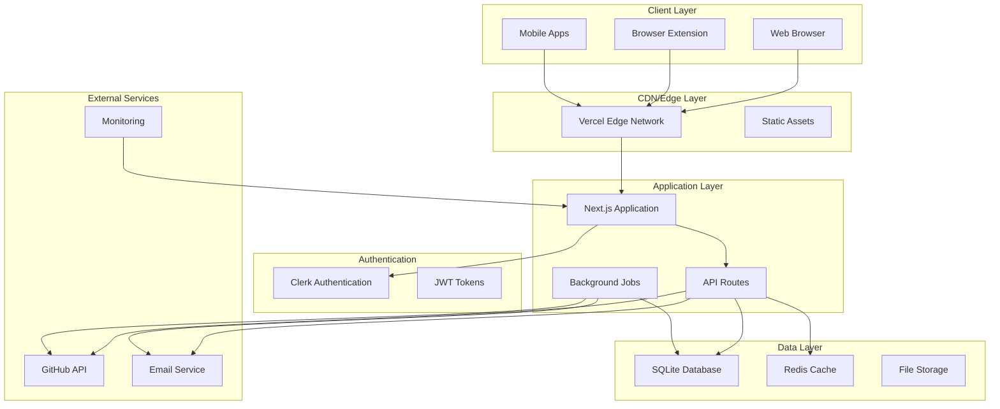

# Production Deployment Guide

## Overview

This guide provides comprehensive instructions for deploying The Pensive Index Community Submission System to production environments. It covers infrastructure setup, configuration management, security considerations, and deployment procedures.

## Prerequisites

### Required Services
- **Vercel Account**: For Next.js application hosting
- **GitHub Repository**: For code hosting and CI/CD
- **Clerk Account**: For authentication services
- **Email Service**: SMTP provider (SendGrid, Mailgun, etc.)
- **Redis Cloud**: For caching (optional but recommended)

### Required Tools
- **Node.js**: 18.0.0 or higher
- **Git**: For version control
- **Vercel CLI**: For deployment management
- **GitHub CLI**: For repository management (optional)

## Infrastructure Architecture

### Production Stack



### Environment Structure

| Environment | Purpose                | URL                           | Database       |
| ----------- | ---------------------- | ----------------------------- | -------------- |
| Development | Local development      | localhost:3000                | Local SQLite   |
| Preview     | PR previews            | preview-*.vercel.app          | Shared test DB |
| Staging     | Pre-production testing | staging.the-pensive-index.org | Staging DB     |
| Production  | Live application       | the-pensive-index.vercel.app  | Production DB  |

## Initial Setup

### 1. Repository Configuration

```bash
# Clone repository
git clone https://github.com/Life-Experimentalists/the-pensive-index.git
cd the-pensive-index

# Install dependencies
npm install

# Set up environment variables
cp .env.example .env.local
```

### 2. Vercel Project Setup

```bash
# Install Vercel CLI
npm install -g vercel

# Login to Vercel
vercel login

# Link to Vercel project
vercel link

# Set up production domains
vercel domains add the-pensive-index.org
vercel domains add www.the-pensive-index.org
```

### 3. Environment Variables Configuration

**Production Environment Variables:**

```bash
# Core Application
NODE_ENV=production
NEXTAUTH_URL=https://the-pensive-index.vercel.app
NEXTAUTH_SECRET=<generate-secure-secret>

# Database
DATABASE_URL=file:./data/the-pensive-index.db
DATABASE_BACKUP_URL=<backup-storage-url>

# Authentication (Clerk)
NEXT_PUBLIC_CLERK_PUBLISHABLE_KEY=pk_live_...
CLERK_SECRET_KEY=sk_live_...
NEXT_PUBLIC_CLERK_SIGN_IN_URL=/sign-in
NEXT_PUBLIC_CLERK_SIGN_UP_URL=/sign-up
NEXT_PUBLIC_CLERK_AFTER_SIGN_IN_URL=/
NEXT_PUBLIC_CLERK_AFTER_SIGN_UP_URL=/

# GitHub Integration
GITHUB_TOKEN=ghp_...
GITHUB_REPO_OWNER=Life-Experimentalists
GITHUB_REPO_NAME=submissions
GITHUB_WEBHOOK_SECRET=<webhook-secret>

# Email Service (SendGrid)
SMTP_HOST=smtp.sendgrid.net
SMTP_PORT=587
SMTP_USER=apikey
SMTP_PASS=<sendgrid-api-key>
FROM_EMAIL=noreply@the-pensive-index.org
FROM_NAME="The Pensive Index"

# Redis Cache (Optional)
REDIS_URL=rediss://:<password>@<host>:<port>
REDIS_PASSWORD=<password>

# Monitoring and Logging
SENTRY_DSN=<sentry-dsn>
VERCEL_ANALYTICS_ID=<analytics-id>

# Security
RATE_LIMIT_REDIS_URL=${REDIS_URL}
CORS_ORIGINS=https://the-pensive-index.org,https://www.the-pensive-index.org

# Feature Flags
ENABLE_COMMUNITY_SUBMISSIONS=true
ENABLE_BROWSER_EXTENSION=true
ENABLE_EMAIL_NOTIFICATIONS=true
```

**Setting Environment Variables in Vercel:**

```bash
# Set environment variables
vercel env add NODE_ENV
vercel env add DATABASE_URL
vercel env add NEXTAUTH_SECRET
# ... continue for all variables

# Or import from file
vercel env pull .env.production
```

## Database Setup

### 1. Production Database Configuration

```bash
# Create production database directory
mkdir -p data/production

# Run migrations
npm run db:migrate:prod

# Seed initial data (admin users, fandoms)
npm run db:seed:prod

# Create initial admin user
npm run admin:create-user -- \
  --email admin@the-pensive-index.org \
  --name "System Administrator" \
  --role super_admin
```

### 2. Database Backup Strategy

```bash
# Set up automated backups
vercel env add DATABASE_BACKUP_SCHEDULE "0 2 * * *" # Daily at 2 AM UTC

# Create backup script
cat > scripts/backup-database.sh << 'EOF'
#!/bin/bash
DATE=$(date +%Y%m%d_%H%M%S)
BACKUP_FILE="backup_${DATE}.db"

# Create backup
sqlite3 data/the-pensive-index.db ".backup ${BACKUP_FILE}"

# Upload to cloud storage (implement based on your provider)
# aws s3 cp ${BACKUP_FILE} s3://your-backup-bucket/
# or use your preferred backup solution

# Clean up local backup file
rm ${BACKUP_FILE}

echo "Backup completed: ${BACKUP_FILE}"
EOF

chmod +x scripts/backup-database.sh
```

### 3. Database Migration Process

```bash
# Create migration deployment script
cat > scripts/deploy-with-migration.sh << 'EOF'
#!/bin/bash
set -e

echo "Starting deployment with database migration..."

# 1. Create database backup
npm run db:backup

# 2. Run pending migrations
npm run db:migrate

# 3. Deploy application
vercel --prod

# 4. Verify deployment health
sleep 30
curl -f https://the-pensive-index.vercel.app/api/health || {
  echo "Health check failed, consider rollback"
  exit 1
}

echo "Deployment completed successfully"
EOF

chmod +x scripts/deploy-with-migration.sh
```

## Deployment Process

### 1. CI/CD Pipeline Setup

Create `.github/workflows/deploy.yml`:

```yaml
name: Production Deployment

on:
  push:
    branches: [main]
  pull_request:
    branches: [main]

jobs:
  test:
    runs-on: ubuntu-latest
    steps:
      - uses: actions/checkout@v4
      - uses: actions/setup-node@v4
        with:
          node-version: '18'
          cache: 'npm'

      - run: npm ci
      - run: npm run lint
      - run: npm run type-check
      - run: npm run test:ci
      - run: npm run build

  deploy-preview:
    if: github.event_name == 'pull_request'
    runs-on: ubuntu-latest
    needs: test
    steps:
      - uses: actions/checkout@v4
      - uses: vercel/action@v29
        with:
          vercel-token: ${{ secrets.VERCEL_TOKEN }}
          vercel-org-id: ${{ secrets.VERCEL_ORG_ID }}
          vercel-project-id: ${{ secrets.VERCEL_PROJECT_ID }}

  deploy-production:
    if: github.ref == 'refs/heads/main'
    runs-on: ubuntu-latest
    needs: test
    environment: production
    steps:
      - uses: actions/checkout@v4

      - name: Setup Node.js
        uses: actions/setup-node@v4
        with:
          node-version: '18'
          cache: 'npm'

      - name: Install dependencies
        run: npm ci

      - name: Run database migrations
        run: npm run db:migrate:ci
        env:
          DATABASE_URL: ${{ secrets.DATABASE_URL }}

      - name: Deploy to Vercel
        uses: vercel/action@v29
        with:
          vercel-token: ${{ secrets.VERCEL_TOKEN }}
          vercel-org-id: ${{ secrets.VERCEL_ORG_ID }}
          vercel-project-id: ${{ secrets.VERCEL_PROJECT_ID }}
          vercel-args: '--prod'

      - name: Run smoke tests
        run: npm run test:smoke
        env:
          TEST_BASE_URL: https://the-pensive-index.vercel.app

  security-scan:
    runs-on: ubuntu-latest
    steps:
      - uses: actions/checkout@v4
      - name: Run security audit
        run: |
          npm audit --audit-level moderate
          npm run security:scan
```

### 2. Manual Deployment Process

```bash
# 1. Pre-deployment checklist
npm run pre-deploy:check

# 2. Run tests
npm run test:all

# 3. Build application
npm run build

# 4. Deploy to production
vercel --prod

# 5. Run post-deployment verification
npm run post-deploy:verify
```

### 3. Deployment Scripts

Create `package.json` scripts:

```json
{
  "scripts": {
    "deploy:prod": "vercel --prod",
    "deploy:staging": "vercel --target staging",
    "pre-deploy:check": "node scripts/pre-deploy-checks.js",
    "post-deploy:verify": "node scripts/post-deploy-verification.js",
    "db:migrate:ci": "node scripts/migrate-database.js",
    "db:backup": "node scripts/backup-database.js",
    "test:smoke": "jest --config jest.smoke.config.js",
    "security:scan": "node scripts/security-scan.js"
  }
}
```

## Configuration Management

### 1. Environment-Specific Configuration

Create `config/production.js`:

```javascript
module.exports = {
  // Application settings
  app: {
    name: 'The Pensive Index',
    url: 'https://the-pensive-index.vercel.app',
    env: 'production'
  },

  // Database settings
  database: {
    url: process.env.DATABASE_URL,
    pool: {
      min: 2,
      max: 10
    },
    backup: {
      enabled: true,
      schedule: '0 2 * * *', // Daily at 2 AM UTC
      retention: 30 // Keep 30 days of backups
    }
  },

  // Cache settings
  cache: {
    redis: {
      url: process.env.REDIS_URL,
      ttl: {
        default: 300,      // 5 minutes
        submissions: 60,   // 1 minute
        fandoms: 3600,     // 1 hour
        users: 900         // 15 minutes
      }
    }
  },

  // Rate limiting
  rateLimit: {
    windowMs: 15 * 60 * 1000, // 15 minutes
    max: {
      anonymous: 100,
      authenticated: 1000,
      admin: 5000
    }
  },

  // Security settings
  security: {
    cors: {
      origin: [
        'https://the-pensive-index.org',
        'https://www.the-pensive-index.org'
      ]
    },
    helmet: {
      contentSecurityPolicy: {
        directives: {
          defaultSrc: ["'self'"],
          scriptSrc: ["'self'", "'unsafe-inline'", "https://clerk.dev"],
          styleSrc: ["'self'", "'unsafe-inline'"],
          imgSrc: ["'self'", "data:", "https:"],
          connectSrc: ["'self'", "https://api.clerk.dev"]
        }
      }
    }
  },

  // Monitoring settings
  monitoring: {
    sentry: {
      dsn: process.env.SENTRY_DSN,
      environment: 'production'
    },
    healthCheck: {
      enabled: true,
      interval: 60000 // 1 minute
    }
  }
};
```

### 2. Feature Flags

Create `config/feature-flags.js`:

```javascript
module.exports = {
  // Community features
  communitySubmissions: process.env.ENABLE_COMMUNITY_SUBMISSIONS === 'true',
  browserExtension: process.env.ENABLE_BROWSER_EXTENSION === 'true',
  mobileApp: process.env.ENABLE_MOBILE_APP === 'true',

  // Admin features
  bulkOperations: true,
  advancedAnalytics: true,
  systemMaintenance: true,

  // Integration features
  githubIntegration: process.env.ENABLE_GITHUB_INTEGRATION === 'true',
  emailNotifications: process.env.ENABLE_EMAIL_NOTIFICATIONS === 'true',
  webhooks: process.env.ENABLE_WEBHOOKS === 'true',

  // Performance features
  redisCaching: Boolean(process.env.REDIS_URL),
  compressionEnabled: true,
  imageOptimization: true
};
```

## Security Configuration

### 1. SSL/TLS Setup

Vercel automatically provides SSL certificates, but verify configuration:

```javascript
// next.config.js
module.exports = {
  async headers() {
    return [
      {
        source: '/(.*)',
        headers: [
          {
            key: 'Strict-Transport-Security',
            value: 'max-age=31536000; includeSubDomains; preload'
          },
          {
            key: 'X-Frame-Options',
            value: 'DENY'
          },
          {
            key: 'X-Content-Type-Options',
            value: 'nosniff'
          },
          {
            key: 'Referrer-Policy',
            value: 'strict-origin-when-cross-origin'
          }
        ]
      }
    ];
  }
};
```

### 2. Authentication Security

```javascript
// lib/auth-config.js
export const authConfig = {
  // Clerk configuration for production
  publishableKey: process.env.NEXT_PUBLIC_CLERK_PUBLISHABLE_KEY,
  secretKey: process.env.CLERK_SECRET_KEY,

  // JWT configuration
  jwt: {
    verifyOptions: {
      issuer: 'https://clerk.dev',
      audience: 'the-pensive-index'
    }
  },

  // Session configuration
  session: {
    strategy: 'jwt',
    maxAge: 24 * 60 * 60, // 24 hours
    updateAge: 24 * 60 * 60 // 24 hours
  }
};
```

### 3. API Security

```javascript
// middleware.ts
import { authMiddleware } from '@clerk/nextjs/server';
import { rateLimit } from './lib/rate-limit';

export default authMiddleware({
  // Rate limiting
  beforeAuth: async (req) => {
    if (req.nextUrl.pathname.startsWith('/api/')) {
      const rateLimitResult = await rateLimit(req);
      if (!rateLimitResult.success) {
        return new Response('Rate limit exceeded', { status: 429 });
      }
    }
  },

  // Public routes (no authentication required)
  publicRoutes: [
    '/',
    '/fandom/(.*)',
    '/api/health',
    '/api/extract/metadata'
  ],

  // Protected API routes
  apiRoutes: [
    '/api/v1/(.*)'
  ]
});

export const config = {
  matcher: ['/((?!.*\\..*|_next).*)', '/', '/(api|trpc)(.*)']
};
```

## Monitoring and Logging

### 1. Application Monitoring

```javascript
// lib/monitoring.js
import * as Sentry from '@sentry/nextjs';

// Initialize Sentry
Sentry.init({
  dsn: process.env.SENTRY_DSN,
  environment: process.env.NODE_ENV,
  tracesSampleRate: 0.1,

  beforeSend(event, hint) {
    // Filter out sensitive data
    if (event.extra) {
      delete event.extra.password;
      delete event.extra.token;
    }
    return event;
  }
});

// Performance monitoring
export const performanceMonitor = {
  startTimer: (operation) => {
    return {
      end: () => {
        const duration = Date.now() - start;
        // Log to monitoring service
        console.log(`Operation ${operation} took ${duration}ms`);
      }
    };
  }
};
```

### 2. Health Checks

Create `pages/api/health.ts`:

```typescript
import { NextApiRequest, NextApiResponse } from 'next';
import { checkDatabaseHealth } from '@/lib/database/health';
import { checkRedisHealth } from '@/lib/cache/health';
import { checkGitHubHealth } from '@/lib/github/health';

export default async function handler(
  req: NextApiRequest,
  res: NextApiResponse
) {
  try {
    const [database, redis, github] = await Promise.allSettled([
      checkDatabaseHealth(),
      checkRedisHealth(),
      checkGitHubHealth()
    ]);

    const status = {
      status: 'healthy',
      timestamp: new Date().toISOString(),
      version: process.env.VERCEL_GIT_COMMIT_SHA || 'unknown',
      services: {
        database: database.status === 'fulfilled' ? 'up' : 'down',
        redis: redis.status === 'fulfilled' ? 'up' : 'down',
        github: github.status === 'fulfilled' ? 'up' : 'down'
      },
      performance: {
        uptime: process.uptime(),
        memory: process.memoryUsage()
      }
    };

    const overallStatus = Object.values(status.services).every(s => s === 'up')
      ? 'healthy'
      : 'degraded';

    res.status(overallStatus === 'healthy' ? 200 : 503).json({
      ...status,
      status: overallStatus
    });
  } catch (error) {
    res.status(500).json({
      status: 'unhealthy',
      timestamp: new Date().toISOString(),
      error: error.message
    });
  }
}
```

### 3. Logging Configuration

```javascript
// lib/logger.js
import winston from 'winston';

const logger = winston.createLogger({
  level: process.env.LOG_LEVEL || 'info',
  format: winston.format.combine(
    winston.format.timestamp(),
    winston.format.errors({ stack: true }),
    winston.format.json()
  ),
  defaultMeta: {
    service: 'pensive-index',
    environment: process.env.NODE_ENV
  },
  transports: [
    // Console output for Vercel
    new winston.transports.Console({
      format: winston.format.simple()
    })
  ]
});

// Add request ID to all logs
export const addRequestId = (req, res, next) => {
  req.requestId = Math.random().toString(36).substring(7);
  logger.defaultMeta.requestId = req.requestId;
  next();
};

export default logger;
```

## Performance Optimization

### 1. Caching Strategy

```javascript
// lib/cache/strategy.js
export const cacheStrategies = {
  // Static content - long TTL
  fandoms: {
    ttl: 3600, // 1 hour
    staleWhileRevalidate: true
  },

  // Dynamic content - short TTL
  submissions: {
    ttl: 60, // 1 minute
    tags: ['submissions']
  },

  // User-specific content
  userProfile: {
    ttl: 900, // 15 minutes
    keyPrefix: 'user:'
  }
};
```

### 2. Database Optimization

```sql
-- Performance indexes for production
CREATE INDEX CONCURRENTLY IF NOT EXISTS idx_submissions_status_created
ON submissions(status, created_at DESC);

CREATE INDEX CONCURRENTLY IF NOT EXISTS idx_submissions_fandom_status
ON submissions(fandom_slug, status)
WHERE status IN ('pending', 'approved');

CREATE INDEX CONCURRENTLY IF NOT EXISTS idx_queue_entries_priority_position
ON queue_entries(priority DESC, queue_position ASC);

-- Query optimization
ANALYZE submissions;
ANALYZE queue_entries;
ANALYZE moderation_actions;
```

### 3. CDN Configuration

```javascript
// next.config.js
module.exports = {
  images: {
    domains: ['images.unsplash.com', 'cdn.the-pensive-index.org'],
    formats: ['image/webp', 'image/avif']
  },

  // Optimize bundles
  webpack: (config, { buildId, dev, isServer, defaultLoaders, webpack }) => {
    if (!dev && !isServer) {
      // Bundle analyzer
      config.plugins.push(
        new webpack.optimize.LimitChunkCountPlugin({
          maxChunks: 50
        })
      );
    }

    return config;
  }
};
```

## Disaster Recovery

### 1. Backup Procedures

```bash
# Automated backup script
#!/bin/bash
set -e

BACKUP_DATE=$(date +%Y%m%d_%H%M%S)
BACKUP_DIR="/tmp/backups"
S3_BUCKET="pensive-index-backups"

mkdir -p ${BACKUP_DIR}

# Database backup
sqlite3 data/the-pensive-index.db ".backup ${BACKUP_DIR}/db_${BACKUP_DATE}.sqlite"

# Environment backup
cp .env.production ${BACKUP_DIR}/env_${BACKUP_DATE}.txt

# Upload to S3
aws s3 sync ${BACKUP_DIR} s3://${S3_BUCKET}/$(date +%Y/%m/%d)/

# Cleanup local files
rm -rf ${BACKUP_DIR}

echo "Backup completed: ${BACKUP_DATE}"
```

### 2. Recovery Procedures

```bash
# Database recovery script
#!/bin/bash
set -e

BACKUP_FILE=$1
if [ -z "$BACKUP_FILE" ]; then
  echo "Usage: $0 <backup_file>"
  exit 1
fi

# Create recovery point
cp data/the-pensive-index.db data/the-pensive-index.db.recovery

# Restore from backup
sqlite3 data/the-pensive-index.db ".restore ${BACKUP_FILE}"

# Verify integrity
sqlite3 data/the-pensive-index.db "PRAGMA integrity_check;"

echo "Recovery completed from: ${BACKUP_FILE}"
```

### 3. Rollback Procedures

```bash
# Application rollback script
#!/bin/bash
set -e

PREVIOUS_DEPLOYMENT=$1
if [ -z "$PREVIOUS_DEPLOYMENT" ]; then
  echo "Usage: $0 <previous_deployment_url>"
  exit 1
fi

# Rollback via Vercel
vercel rollback ${PREVIOUS_DEPLOYMENT} --yes

# Verify rollback
sleep 30
curl -f https://the-pensive-index.vercel.app/api/health || {
  echo "Rollback verification failed"
  exit 1
}

echo "Rollback completed to: ${PREVIOUS_DEPLOYMENT}"
```

## Post-Deployment Checklist

### Immediate Verification (0-5 minutes)

- [ ] Application loads without errors
- [ ] Health check endpoint returns 200
- [ ] Authentication system works
- [ ] Database connections successful
- [ ] GitHub integration functional
- [ ] Email service operational

### Extended Verification (5-30 minutes)

- [ ] Story submission workflow works end-to-end
- [ ] Admin dashboard accessible and functional
- [ ] Browser extension connects to API
- [ ] Email notifications sending correctly
- [ ] Performance metrics within acceptable ranges
- [ ] Error rates below threshold (< 1%)

### Long-term Monitoring (ongoing)

- [ ] Set up monitoring alerts
- [ ] Verify backup procedures
- [ ] Monitor performance trends
- [ ] Review security logs
- [ ] Check rate limiting effectiveness
- [ ] Validate data integrity

This production deployment guide provides comprehensive coverage of deployment procedures, security configuration, and operational best practices for The Pensive Index Community Submission System.