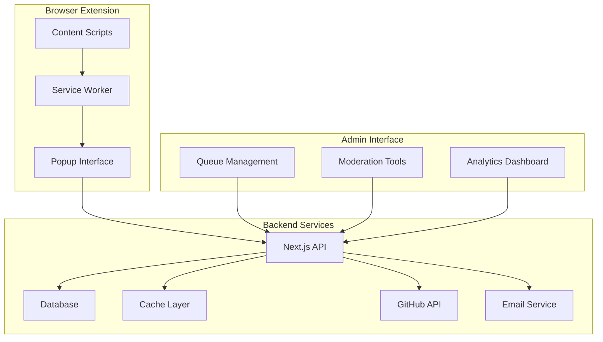

# Community Submission System Development Guide

## Quick Start

The Community Submission System enables users to submit stories via browser extension with GitHub-integrated moderation workflows. This guide covers development setup, architecture, and contribution guidelines.

### Prerequisites

- **Node.js**: 18.0.0 or higher
- **Git**: For version control
- **Browser**: Chrome/Edge for extension development
- **Editor**: VS Code recommended with extensions

### Development Setup

```bash
# Clone repository
git clone https://github.com/your-org/the-pensive-index.git
cd the-pensive-index

# Install dependencies
npm install

# Setup environment variables
cp .env.example .env.local
# Edit .env.local with your configuration

# Setup database
npm run db:migrate
npm run db:seed

# Start development server
npm run dev
```

### Environment Configuration

```bash
# .env.local
DATABASE_URL="file:./data/the-pensive-index.db"
NEXTAUTH_SECRET="your-secret-key"
NEXTAUTH_URL="http://localhost:3000"

# GitHub Integration
GITHUB_TOKEN="github_pat_..."
GITHUB_REPO="your-org/submissions"
GITHUB_WEBHOOK_SECRET="webhook-secret"

# Email Service (optional for development)
SMTP_HOST="smtp.example.com"
SMTP_PORT=587
SMTP_USER="your-email@example.com"
SMTP_PASS="your-password"

# Redis Cache (optional)
REDIS_URL="redis://localhost:6379"
```

## Architecture Overview

### System Components



### Technology Stack

#### Frontend
- **Next.js 14+**: App Router with React Server Components
- **React 18+**: UI components and interactions
- **Tailwind CSS**: Styling and responsive design
- **TypeScript**: Type safety and development experience

#### Backend
- **Node.js**: Runtime environment
- **Drizzle ORM**: Database operations and migrations
- **SQLite**: Primary database (with PostgreSQL support)
- **Redis**: Caching layer (optional)

#### External Integrations
- **GitHub API**: Issue tracking and webhooks
- **Clerk**: Authentication and user management
- **Email Service**: SMTP for notifications
- **Browser APIs**: Extension functionality

## Development Workflow

### Project Structure

```
the-pensive-index/
├── app/                    # Next.js App Router
│   ├── api/               # API routes
│   ├── admin/             # Admin dashboard
│   └── (auth)/            # Authentication pages
├── src/
│   ├── components/        # React components
│   ├── lib/               # Utility libraries
│   ├── types/             # TypeScript definitions
│   └── extension/         # Browser extension
├── tests/
│   ├── components/        # Component tests
│   ├── e2e/              # End-to-end tests
│   └── contracts/         # API contract tests
├── migrations/            # Database migrations
└── wiki/                  # Documentation
```

### Development Commands

```bash
# Development
npm run dev                 # Start development server
npm run dev:extension      # Build extension for development

# Testing
npm run test              # Run unit tests
npm run test:watch        # Watch mode
npm run test:e2e          # End-to-end tests
npm run test:contracts    # API contract tests

# Database
npm run db:migrate        # Run migrations
npm run db:seed           # Seed test data
npm run db:studio         # Database GUI

# Building
npm run build             # Production build
npm run build:extension   # Extension production build

# Code Quality
npm run lint              # ESLint checking
npm run type-check        # TypeScript validation
npm run format            # Prettier formatting
```

### Branching Strategy

```bash
# Feature development
git checkout -b feature/submission-queue-optimization
git commit -m "feat: optimize submission queue performance"
git push origin feature/submission-queue-optimization

# Bug fixes
git checkout -b fix/extension-parsing-error
git commit -m "fix: resolve AO3 parsing issue with new layout"

# Hotfixes
git checkout -b hotfix/critical-security-patch
git commit -m "security: patch XSS vulnerability in admin dashboard"
```

## API Development

### Route Structure

```typescript
// app/api/v1/submissions/route.ts
import { NextRequest, NextResponse } from 'next/server';
import { SubmissionService } from '@/lib/services/submission-service';

export async function POST(request: NextRequest) {
  try {
    const body = await request.json();
    const service = new SubmissionService();
    const result = await service.createSubmission(body);

    return NextResponse.json({
      success: true,
      submissionId: result.id,
      githubIssueNumber: result.githubIssueNumber,
    });
  } catch (error) {
    return NextResponse.json(
      { error: 'Submission failed' },
      { status: 500 }
    );
  }
}
```

### Service Layer Pattern

```typescript
// src/lib/services/submission-service.ts
export class SubmissionService {
  constructor(
    private db = database,
    private github = new GitHubService(),
    private email = new EmailService()
  ) {}

  async createSubmission(data: SubmissionData): Promise<Submission> {
    // 1. Validate submission data
    const validatedData = await this.validateSubmission(data);

    // 2. Store in database
    const submission = await this.db.submissions.create(validatedData);

    // 3. Create GitHub issue
    const issueNumber = await this.github.createIssue(submission);

    // 4. Update submission with GitHub info
    await this.db.submissions.update(submission.id, {
      githubIssueNumber: issueNumber
    });

    // 5. Send confirmation email
    await this.email.sendSubmissionConfirmation(submission);

    return submission;
  }
}
```

### Error Handling

```typescript
// src/lib/errors/api-errors.ts
export class APIError extends Error {
  constructor(
    public message: string,
    public statusCode: number = 500,
    public code?: string
  ) {
    super(message);
    this.name = 'APIError';
  }
}

// Usage in API routes
export async function POST(request: NextRequest) {
  try {
    // API logic
  } catch (error) {
    if (error instanceof APIError) {
      return NextResponse.json(
        { error: error.message, code: error.code },
        { status: error.statusCode }
      );
    }

    // Log unexpected errors
    console.error('Unexpected API error:', error);
    return NextResponse.json(
      { error: 'Internal server error' },
      { status: 500 }
    );
  }
}
```

## Database Development

### Schema Management

```typescript
// src/lib/database/schema.ts
import { sqliteTable, text, integer, boolean } from 'drizzle-orm/sqlite-core';

export const submissions = sqliteTable('submissions', {
  id: text('id').primaryKey(),
  storyTitle: text('story_title').notNull(),
  storyUrl: text('story_url').notNull(),
  storyAuthor: text('story_author').notNull(),
  fandomSlug: text('fandom_slug').notNull(),
  status: text('status').notNull().default('pending'),
  priority: text('priority').notNull().default('normal'),
  submitterEmail: text('submitter_email').notNull(),
  githubIssueNumber: integer('github_issue_number'),
  submissionDate: integer('submission_date').notNull(),
  createdAt: integer('created_at').notNull(),
  updatedAt: integer('updated_at').notNull(),
});

export type Submission = typeof submissions.$inferSelect;
export type NewSubmission = typeof submissions.$inferInsert;
```

### Migration System

```sql
-- migrations/005_add_submission_priority.sql
-- Add priority field to submissions table

BEGIN;

-- Add priority column with default value
ALTER TABLE submissions ADD COLUMN priority TEXT NOT NULL DEFAULT 'normal';

-- Create index for priority-based queries
CREATE INDEX idx_submissions_priority_status ON submissions(priority, status, submission_date DESC);

-- Update existing submissions to normal priority
UPDATE submissions SET priority = 'normal' WHERE priority IS NULL;

COMMIT;
```

### Query Optimization

```typescript
// Optimized query with proper indexing
export async function getSubmissionQueue(filters: QueueFilters) {
  return await db
    .select({
      id: submissions.id,
      title: submissions.storyTitle,
      author: submissions.storyAuthor,
      status: submissions.status,
      priority: submissions.priority,
      submissionDate: submissions.submissionDate,
      moderator: adminUsers.name,
    })
    .from(submissions)
    .leftJoin(adminUsers, eq(submissions.assignedModeratorId, adminUsers.id))
    .where(
      and(
        filters.status ? eq(submissions.status, filters.status) : undefined,
        filters.fandom ? eq(submissions.fandomSlug, filters.fandom) : undefined,
        filters.moderator ? eq(submissions.assignedModeratorId, filters.moderator) : undefined
      )
    )
    .orderBy(desc(submissions.priority), asc(submissions.submissionDate))
    .limit(50);
}
```

## Extension Development

### Manifest Configuration

```json
{
  "manifest_version": 3,
  "name": "The Pensive Index",
  "version": "1.0.0",
  "description": "Submit stories to The Pensive Index directly from fanfiction sites",

  "permissions": [
    "activeTab",
    "storage"
  ],

  "host_permissions": [
    "*://*.archiveofourown.org/*",
    "*://*.fanfiction.net/*"
  ],

  "background": {
    "service_worker": "service-worker.js"
  },

  "content_scripts": [{
    "matches": [
      "*://*.archiveofourown.org/*",
      "*://*.fanfiction.net/*"
    ],
    "js": ["content-script.js"]
  }],

  "action": {
    "default_popup": "popup.html",
    "default_title": "Submit to The Pensive Index"
  }
}
```

### Content Script Development

```typescript
// src/extension/content-scripts/ao3-parser.ts
export class AO3Parser implements SiteParser {
  canParse(url: string): boolean {
    return url.includes('archiveofourown.org/works/');
  }

  async parseStoryData(): Promise<StoryMetadata> {
    const title = this.querySelector('h2.title')?.textContent?.trim();
    const author = this.querySelector('a[rel="author"]')?.textContent?.trim();
    const description = this.querySelector('.summary .userstuff')?.textContent?.trim();

    const tags = Array.from(this.querySelectorAll('.tag'))
      .map(tag => tag.textContent?.trim())
      .filter(Boolean);

    return {
      title,
      author,
      description,
      url: window.location.href,
      tags,
      site: 'ao3',
      parsedAt: new Date().toISOString(),
    };
  }

  private querySelector(selector: string): Element | null {
    return document.querySelector(selector);
  }

  private querySelectorAll(selector: string): NodeListOf<Element> {
    return document.querySelectorAll(selector);
  }
}
```

### Service Worker Communication

```typescript
// src/extension/service-worker.ts
chrome.runtime.onMessage.addListener((message, sender, sendResponse) => {
  switch (message.type) {
    case 'PARSE_STORY':
      handleStoryParsing(message.data)
        .then(sendResponse)
        .catch(error => sendResponse({ error: error.message }));
      return true; // Async response

    case 'SUBMIT_STORY':
      handleStorySubmission(message.data)
        .then(sendResponse)
        .catch(error => sendResponse({ error: error.message }));
      return true;
  }
});

async function handleStorySubmission(storyData: StoryData) {
  const apiUrl = process.env.NODE_ENV === 'development'
    ? 'http://localhost:3000'
    : 'https://the-pensive-index.vercel.app';

  const response = await fetch(`${apiUrl}/api/v1/submissions`, {
    method: 'POST',
    headers: {
      'Content-Type': 'application/json',
      'X-Extension-Version': chrome.runtime.getManifest().version,
    },
    body: JSON.stringify(storyData),
  });

  if (!response.ok) {
    throw new Error(`Submission failed: ${response.statusText}`);
  }

  return await response.json();
}
```

## Testing Strategy

### Unit Testing

```typescript
// tests/components/submission-form.test.tsx
import { render, screen, fireEvent, waitFor } from '@testing-library/react';
import { SubmissionForm } from '@/components/submission-form';

describe('SubmissionForm', () => {
  it('should validate required fields', async () => {
    render(<SubmissionForm />);

    const submitButton = screen.getByRole('button', { name: /submit/i });
    fireEvent.click(submitButton);

    await waitFor(() => {
      expect(screen.getByText('Title is required')).toBeInTheDocument();
      expect(screen.getByText('Author is required')).toBeInTheDocument();
    });
  });

  it('should submit valid form data', async () => {
    const mockSubmit = vi.fn();
    render(<SubmissionForm onSubmit={mockSubmit} />);

    fireEvent.change(screen.getByLabelText('Title'), {
      target: { value: 'Test Story' }
    });
    fireEvent.change(screen.getByLabelText('Author'), {
      target: { value: 'Test Author' }
    });

    fireEvent.click(screen.getByRole('button', { name: /submit/i }));

    await waitFor(() => {
      expect(mockSubmit).toHaveBeenCalledWith({
        title: 'Test Story',
        author: 'Test Author',
      });
    });
  });
});
```

### API Contract Testing

```typescript
// tests/contracts/submission-api.test.ts
describe('Submission API Contract', () => {
  it('should create submission with valid data', async () => {
    const validSubmission = {
      storyTitle: 'Test Story',
      storyAuthor: 'Test Author',
      storyUrl: 'https://archiveofourown.org/works/123',
      fandomSlug: 'harry-potter',
      submitterEmail: 'test@example.com',
    };

    const response = await fetch('/api/v1/submissions', {
      method: 'POST',
      headers: { 'Content-Type': 'application/json' },
      body: JSON.stringify(validSubmission),
    });

    expect(response.status).toBe(200);

    const result = await response.json();
    expect(result).toMatchObject({
      success: true,
      submissionId: expect.stringMatching(/^sub_/),
      githubIssueNumber: expect.any(Number),
    });
  });
});
```

### End-to-End Testing

```typescript
// tests/e2e/submission-workflow.test.ts
import { test, expect } from '@playwright/test';

test('complete submission workflow', async ({ page }) => {
  // Navigate to story page
  await page.goto('https://archiveofourown.org/works/123456');

  // Open extension popup
  await page.click('[data-testid="extension-icon"]');

  // Verify story data parsed
  await expect(page.locator('[data-testid="story-title"]'))
    .toHaveValue('Expected Story Title');

  // Fill submission form
  await page.selectOption('[data-testid="fandom"]', 'harry-potter');
  await page.fill('[data-testid="email"]', 'test@example.com');
  await page.check('[data-testid="terms-agreement"]');

  // Submit story
  await page.click('[data-testid="submit-button"]');

  // Verify success
  await expect(page.locator('[data-testid="success-message"]'))
    .toBeVisible();

  // Verify submission appears in admin queue
  await page.goto('/admin/submissions');
  await expect(page.locator('[data-testid="submission-card"]'))
    .toContainText('Expected Story Title');
});
```

## Deployment

### Production Build

```bash
# Build application
npm run build

# Build extension
npm run build:extension

# Run production checks
npm run lint
npm run type-check
npm run test

# Deploy to Vercel
vercel deploy --prod
```

### Environment Setup

```yaml
# .github/workflows/deploy.yml
name: Deploy to Production
on:
  push:
    branches: [main]

jobs:
  deploy:
    runs-on: ubuntu-latest
    steps:
      - uses: actions/checkout@v4
      - uses: actions/setup-node@v4
        with:
          node-version: '18'
          cache: 'npm'

      - run: npm ci
      - run: npm run test
      - run: npm run build

      - name: Deploy to Vercel
        uses: amondnet/vercel-action@v25
        with:
          vercel-token: ${{ secrets.VERCEL_TOKEN }}
          vercel-org-id: ${{ secrets.ORG_ID }}
          vercel-project-id: ${{ secrets.PROJECT_ID }}
          vercel-args: '--prod'
```

### Database Migration

```bash
# Production migration process
npm run db:migrate:prod

# Backup before migration
npm run db:backup

# Verify migration success
npm run db:verify
```

## Contributing Guidelines

### Code Standards

#### TypeScript
- Use strict mode with no `any` types
- Define interfaces for all data structures
- Use const assertions for readonly data
- Prefer type guards over type assertions

#### React Components
- Use functional components with hooks
- Extract custom hooks for reusable logic
- Implement proper TypeScript props interfaces
- Follow React 18+ best practices

#### Database Queries
- Use Drizzle ORM for type-safe queries
- Implement proper error handling
- Optimize queries with appropriate indexes
- Use transactions for multi-step operations

### Pull Request Process

1. **Fork Repository**
   ```bash
   git clone https://github.com/your-username/the-pensive-index.git
   cd the-pensive-index
   git remote add upstream https://github.com/original-org/the-pensive-index.git
   ```

2. **Create Feature Branch**
   ```bash
   git checkout -b feature/your-feature-name
   ```

3. **Development**
   - Write tests for new functionality
   - Ensure all tests pass
   - Follow code style guidelines
   - Update documentation as needed

4. **Submit Pull Request**
   - Clear description of changes
   - Reference related issues
   - Include screenshots for UI changes
   - Ensure CI checks pass

### Code Review Checklist

#### Functionality
- [ ] Feature works as described
- [ ] Edge cases are handled
- [ ] Error handling is appropriate
- [ ] Performance is acceptable

#### Code Quality
- [ ] TypeScript types are correct
- [ ] No unused code or imports
- [ ] Consistent naming conventions
- [ ] Proper component structure

#### Testing
- [ ] Unit tests cover new functionality
- [ ] Integration tests pass
- [ ] Manual testing completed
- [ ] Performance impact assessed

#### Documentation
- [ ] Code is well-commented
- [ ] API documentation updated
- [ ] User guides updated if needed
- [ ] Changelog entries added

## Performance Guidelines

### Frontend Optimization
- Use React.memo() for expensive components
- Implement proper key props for lists
- Lazy load routes and components
- Optimize images and assets

### Backend Optimization
- Implement database query optimization
- Use caching for frequently accessed data
- Monitor API response times
- Implement rate limiting

### Extension Optimization
- Minimize content script injection
- Use efficient DOM queries
- Implement proper error boundaries
- Monitor memory usage

## Security Guidelines

### Input Validation
- Validate all user inputs
- Sanitize data before database storage
- Use parameterized queries
- Implement CORS policies

### Authentication
- Use secure session management
- Implement proper role-based access
- Validate permissions on all routes
- Use HTTPS in production

### Extension Security
- Minimize permissions requested
- Validate all external communications
- Implement Content Security Policy
- Secure API communications

## Monitoring and Maintenance

### Performance Monitoring
- Track API response times
- Monitor database query performance
- Watch extension resource usage
- Set up alerting for issues

### Error Tracking
- Implement comprehensive error logging
- Set up error reporting service
- Monitor user-reported issues
- Track extension crash rates

### Maintenance Tasks
- Regular dependency updates
- Database optimization
- Cache management
- Performance reviews

This development guide provides comprehensive coverage of the community submission system architecture, development practices, and contribution guidelines. Follow these patterns and practices to maintain code quality and system reliability.